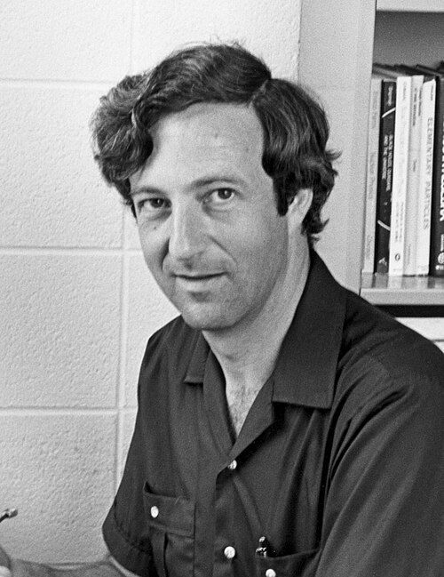

# Saul Teukolsky

**Born:** 2 August 1947

**Died / status:** Living (as of 2026-10-26)

**Fields:** General relativity, Gravitational waves

Sourced portrait or photograph; see the image record for provenance and reuse conditions.

## Biography

A South African-born American theorist associated with Cornell and Caltech, Teukolsky combines black-hole perturbation theory with numerical relativity. His methods support gravitational-wave models and observations.

## Major contributions to physics

- Derived the Teukolsky equation for rotating-black-hole perturbations.
- Advanced numerical relativity and binary-black-hole simulations.
- Developed computational models for gravitational-wave interpretation.

## Image source and rights

- Source: [Original image record](https://commons.wikimedia.org/wiki/File:SaulTeukolsky1975.jpg)
- Creator / attribution: A. T. Service
- License or rights statement: [CC BY-SA 3.0](https://creativecommons.org/licenses/by-sa/3.0)
- Local image: [4fbc28e8a6fd0e3fbcb0-4b0d823007.jpg](../portraits/4fbc28e8a6fd0e3fbcb0-4b0d823007.jpg)
- Credit: Own work

## Sources

- [Saul Teukolsky — reference biography (en.wikipedia.org)](https://en.wikipedia.org/wiki/Saul_Teukolsky)
- [Saul Teukolsky — institutional or scholarly source (www.ictp.it)](https://www.ictp.it/home/dirac-medallists-2021)
- [Saul Teukolsky — institutional or scholarly source (astro.cornell.edu)](https://astro.cornell.edu/saul-teukolsky)
- [Saul Teukolsky — institutional or scholarly source (www.ictp.it)](https://www.ictp.it/prize/dirac-medal)

Record reviewed: 2026-10-26.
