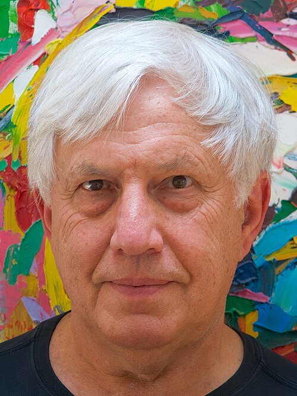

# Andrei Linde

**Born:** 2 March 1948

**Died / status:** Living (as of 2026-10-26)

**Fields:** Cosmology, Quantum field theory

Sourced photograph or portrait; the image record identifies its creator, provenance, and reuse conditions.

## Biography

A Russian-born theorist who worked at the Lebedev Institute before joining Stanford, Linde developed several inflationary models. He investigated early-universe scalar-field dynamics and quantum cosmology.

## Major contributions to physics

- Developed new and chaotic inflation.
- Developed the picture of self-reproducing inflationary universes.
- Investigated scalar fields, vacuum transitions, and cosmological initial conditions.

## Image source and rights

- Source: [Original image record](https://commons.wikimedia.org/wiki/File:Andrei_Linde_2018.jpg)
- Creator / attribution: Hypermultiplet
- License or rights statement: [CC BY-SA 4.0](https://creativecommons.org/licenses/by-sa/4.0)
- Local image: [1a584425684e0dfa26f7.jpg](../portraits/1a584425684e0dfa26f7.jpg)
- Credit: Own work

## Sources

- [Andrei Linde — biographical or institutional source (profiles.stanford.edu)](https://profiles.stanford.edu/andrei-linde)
- [Andrei Linde — reference biography (en.wikipedia.org)](https://en.wikipedia.org/wiki/Andrei_Linde)

Record reviewed: 2026-10-26.
