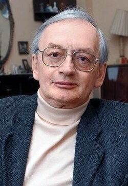

# Alexei Starobinsky

**Born:** 19 April 1948

**Died / status:** 21 December 2023

**Fields:** Cosmology, Quantum gravity

Sourced portrait or photograph; see the image record for provenance and reuse conditions.

## Biography

A Russian theorist at the Landau Institute, Starobinsky studied quantum fields coupled to gravity, proposed an early inflationary model, and investigated cosmological fluctuations and quantum black-hole processes.

## Major contributions to physics

- Developed curvature-squared Starobinsky inflation.
- Investigated inflationary quantum fluctuations and seeds of cosmic structure.
- Studied curved-spacetime quantum fields and black-hole radiation.

## Image source and rights

- Source: [Original image record](https://commons.wikimedia.org/wiki/File:Alexei_Starobinsky,_recipient_of_the_2013_Gruber_Prize_(iau1304b).tif)
- Creator / attribution: Gruber Foundation
- License or rights statement: [CC BY 4.0](https://creativecommons.org/licenses/by/4.0)
- Local image: [02e0d933016b400dc9e9-f1f161405c.jpg](../portraits/02e0d933016b400dc9e9-f1f161405c.jpg)
- Credit: This media was produced by the International Astronomical Union (IAU), under the identifier iau1304b. This tag does not indicate the copyright status of the attached work. A normal copyright tag is still required. See Commons:Licensing.

## Sources

- [Alexei Starobinsky — reference biography (en.wikipedia.org)](https://en.wikipedia.org/wiki/Alexei_Starobinsky)
- [Alexei Starobinsky — institutional or scholarly source (gruber.yale.edu)](https://gruber.yale.edu/press/2013-gruber-cosmology-prize-press-release)
- [Alexei Starobinsky — institutional or scholarly source (www.ictp.it)](https://www.ictp.it/prize/dirac-medal)

Record reviewed: 2026-10-26.
