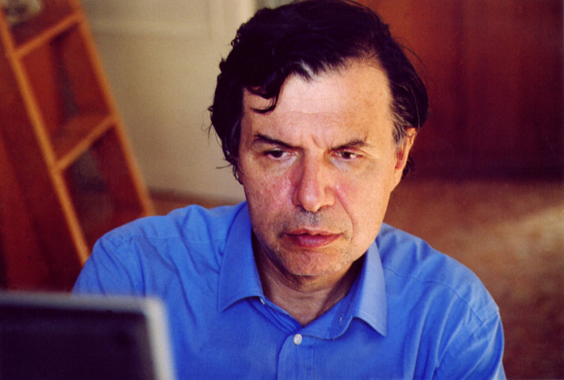

# Giorgio Parisi

**Born:** 4 August 1948

**Died / status:** Living (as of 2026-10-26)

**Fields:** Statistical physics, Complex systems

For the photographer or artist, date and type of image, consult the original image record.

## Biography

Giorgio Parisi was born in Rome, Italy and conducted research in statistical physics and complex systems. Nobel records list Sapienza University of Rome as the affiliation at the time of the award. They developed the theory of spin glasses and disordered systems. They were awarded the Nobel Prize in Physics in 2021.

## Major contributions to physics

- Developed the theory of spin glasses and disordered systems
- Revealed complex organization arising from disorder and fluctuations

**Nobel Prize in Physics:** 2021

## Image source and rights

- Source: [Original image record](https://commons.wikimedia.org/wiki/File:Parisi_giorgio.jpg)
- Creator / attribution: Lorenza Parisi
- License or rights statement: [CC BY-SA 4.0](https://commons.wikimedia.org/wiki/File:Parisi_giorgio.jpg)
- Local image: [b8c40ae1c9c842472450.jpg](../portraits/b8c40ae1c9c842472450.jpg)
- Credit: Own work

## Sources

- [Giorgio Parisi - Facts](https://www.nobelprize.org/prizes/physics/2021/parisi/facts/)
- [Nobel Prize official laureate API, id 1001](https://api.nobelprize.org/2.1/laureate/1001)
- [Wikipedia: Giorgio Parisi](https://en.wikipedia.org/wiki/Giorgio_Parisi)

Record reviewed: 2026-10-26.
