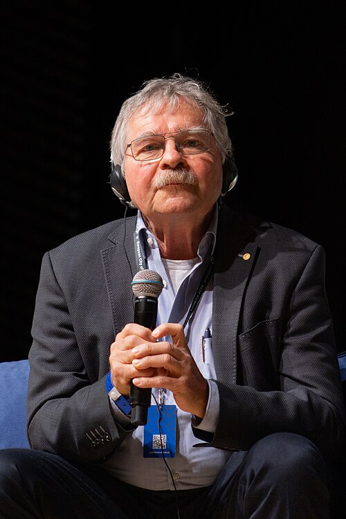

# J. Georg Bednorz

**Born:** 16 May 1950

**Died / status:** Living (as of 2026-10-26)

**Fields:** Condensed-matter physics, Superconductivity

For the photographer or artist, date and type of image, consult the original image record.

## Biography

J. Georg Bednorz was born in Neuenkirchen, West Germany (now Germany) and conducted research in condensed-matter physics and superconductivity. Nobel records list IBM Zurich Research Laboratory as the affiliation at the time of the award. They discovered high-temperature superconductivity in copper-oxide materials. They were awarded the Nobel Prize in Physics in 1987.

## Major contributions to physics

- Discovered high-temperature superconductivity in copper-oxide materials
- Opened new research on unconventional superconductivity and strongly correlated electrons

**Nobel Prize in Physics:** 1987

## Image source and rights

- Source: [Original image record](https://commons.wikimedia.org/wiki/File:8th_Silesian_Science_Festival,_Johannes_Georg_Bednorz,_KsP_709,_09.12.2024.jpg)
- Creator / attribution: Krzysztof Popławski
- License or rights statement: [CC BY-SA 4.0](https://creativecommons.org/licenses/by-sa/4.0)
- Local image: [37fea2fffb06655faffe.jpg](../portraits/37fea2fffb06655faffe.jpg)
- Credit: Own work

## Sources

- [J. Georg Bednorz - Facts](https://www.nobelprize.org/prizes/physics/1987/bednorz/facts/)
- [Nobel Prize official laureate API, id 130](https://api.nobelprize.org/2.1/laureate/130)
- [Wikipedia: Georg Bednorz](https://en.wikipedia.org/wiki/Georg_Bednorz)

Record reviewed: 2026-10-26.
