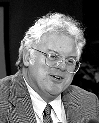

# Robert B. Laughlin

**Born:** 1 November 1950

**Died / status:** Living (as of 2026-10-26)

**Fields:** Condensed-matter physics, Fractional quantum Hall effect

For the photographer or artist, date and type of image, consult the original image record.

## Biography

Robert B. Laughlin was born in Visalia, CA, USA and conducted research in condensed-matter physics and fractional quantum Hall effect. Nobel records list Stanford University as the affiliation at the time of the award. They investigated the fractional quantum Hall effect in two-dimensional electron systems. They were awarded the Nobel Prize in Physics in 1998.

## Major contributions to physics

- Investigated the fractional quantum Hall effect in two-dimensional electron systems
- Revealed strongly correlated quantum states with fractionalized excitations

**Nobel Prize in Physics:** 1998

## Image source and rights

- Source: [Original image record](https://commons.wikimedia.org/wiki/File:Robert_Laughlin%2C_Stanford_University.jpg)
- Creator / attribution: Linda A. Cicero / Stanford News Service
- License or rights statement: [CC BY 3.0](https://commons.wikimedia.org/wiki/File:Robert_Laughlin%2C_Stanford_University.jpg)
- Local image: [33331095003c25d152f1.jpg](../portraits/33331095003c25d152f1.jpg)
- Credit: Stanford News Service

## Sources

- [Robert B. Laughlin - Facts](https://www.nobelprize.org/prizes/physics/1998/laughlin/facts/)
- [Nobel Prize official laureate API, id 155](https://api.nobelprize.org/2.1/laureate/155)
- [Wikipedia: Robert B. Laughlin](https://en.wikipedia.org/wiki/Robert_B._Laughlin)

Record reviewed: 2026-10-26.
