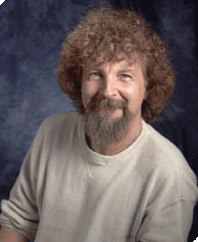

# Wojciech H. Zurek

**Born:** 1951

**Died / status:** Living (as of 2026-10-26)

**Fields:** Quantum foundations, Quantum information

Sourced portrait or photograph; see the image record for provenance and reuse conditions.

## Biography

A Polish-born American theorist at Los Alamos, Zurek investigates how environments select stable quantum states. His work connects decoherence, information, and nonequilibrium phase transitions.

## Major contributions to physics

- Developed environmental decoherence and pointer-state selection.
- Proposed the quantum-Darwinism framework.
- Developed Kibble–Zurek scaling of nonequilibrium transitions.

## Historical and source notes

- The sources reviewed establish the birth year; an unverified month and day have not been added.

## Image source and rights

- Source: [Original image record](https://commons.wikimedia.org/wiki/File:Wojciech_H._Zurek.gif)
- Creator / attribution: The original uploader was Fercook at English Wikipedia.
- License or rights statement: Attribution
- Local image: [1f8a959460280b79fd29-bcf49e0716.gif](../portraits/1f8a959460280b79fd29-bcf49e0716.gif)
- Credit: Transferred from en.wikipedia to Commons by Nobunaga24 using CommonsHelper.

## Sources

- [Wojciech H. Zurek — reference biography (en.wikipedia.org)](https://en.wikipedia.org/wiki/Wojciech_H._Zurek)

Record reviewed: 2026-10-26.
