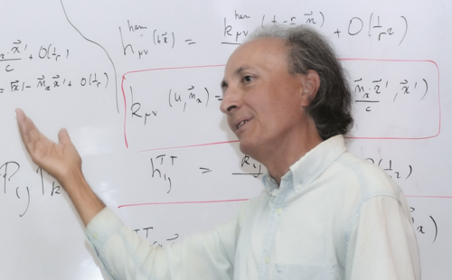

# Thibault Damour

**Born:** 7 February 1951

**Died / status:** Living (as of 2026-10-26)

**Fields:** General relativity, Gravitational waves

Sourced portrait or photograph; see the image record for provenance and reuse conditions.

## Biography

A French theorist at IHES, Damour connects precision relativistic calculations with compact binaries, gravitational waves, and tests of gravity. He also studies cosmology and string theory.

## Major contributions to physics

- Developed high-order post-Newtonian compact-binary dynamics.
- Introduced effective-one-body gravitational-wave models with Buonanno.
- Advanced binary-pulsar and precision-relativity tests.

## Image source and rights

- Source: [Original image record](https://commons.wikimedia.org/wiki/File:Thibault_Damour_portrait.png)
- Creator / attribution: MyName (Melirius (talk))
- License or rights statement: [CC BY 3.0](https://creativecommons.org/licenses/by/3.0)
- Local image: [ff6f4b8838524528bb3a-5d9fb8c1f5.png](../portraits/ff6f4b8838524528bb3a-5d9fb8c1f5.png)
- Credit: Own work

## Sources

- [Thibault Damour — reference biography (en.wikipedia.org)](https://en.wikipedia.org/wiki/Thibault_Damour)
- [Thibault Damour — institutional or scholarly source (www.ictp.it)](https://www.ictp.it/about-ictp/prizes-awards/the-dirac-medal/the-medallists/dirac-medallists-2021.aspx)
- [Thibault Damour — institutional or scholarly source (www.ictp.it)](https://www.ictp.it/prize/dirac-medal)

Record reviewed: 2026-10-26.
