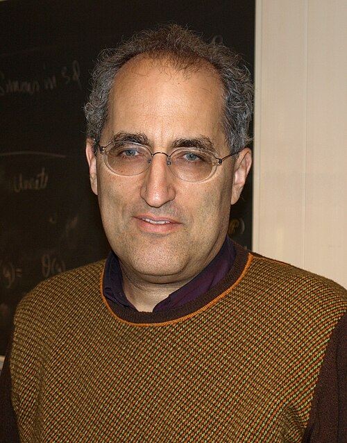

# Edward Witten

**Born:** 26 August 1951

**Died / status:** Living (as of 2026-10-26)

**Fields:** String theory, Mathematical physics

Sourced photograph or portrait; the image record identifies its creator, provenance, and reuse conditions.

## Biography

An American theorist with a Princeton doctorate, Witten works at the Institute for Advanced Study. He links quantum field theory with geometry and topology, promoting deep exchanges between physics and mathematics; he received the Fields Medal in 1990.

## Major contributions to physics

- Developed topological quantum field theory and connections with geometric invariants.
- Advanced string dualities and M-theory.
- Investigated nonperturbative supersymmetric gauge theories with Seiberg and others.

## Image source and rights

- Source: [Original image record](https://commons.wikimedia.org/wiki/File:Edward_Witten.jpg)
- Creator / attribution: Ojan
- License or rights statement: Public domain
- Local image: [0603b34105ad24577b4b.jpg](../portraits/0603b34105ad24577b4b.jpg)
- Credit: Own work

## Sources

- [Edward Witten — biographical or institutional source (www.ias.edu)](https://www.ias.edu/scholars/witten)
- [Edward Witten — reference biography (en.wikipedia.org)](https://en.wikipedia.org/wiki/Edward_Witten)

Record reviewed: 2026-10-26.
