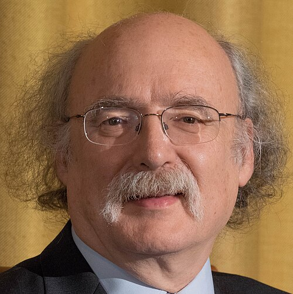

# F. Duncan M. Haldane

**Born:** 14 September 1951

**Died / status:** Living (as of 2026-10-26)

**Fields:** Condensed-matter physics, Topological matter

For the photographer or artist, date and type of image, consult the original image record.

## Biography

F. Duncan M. Haldane was born in London, United Kingdom and conducted research in condensed-matter physics and topological matter. Nobel records list Princeton University as the affiliation at the time of the award. They proposed the Haldane conjecture and predicted an excitation gap in integer-spin antiferromagnetic Heisenberg chains. They were awarded the Nobel Prize in Physics in 2016.

## Major contributions to physics

- Proposed the Haldane conjecture and predicted an excitation gap in integer-spin antiferromagnetic Heisenberg chains
- Proposed a lattice model exhibiting a quantum Hall effect without a net magnetic field

**Nobel Prize in Physics:** 2016

## Image source and rights

- Source: [Original image record](https://commons.wikimedia.org/wiki/File:Duncan_Haldane.jpg)
- Creator / attribution: Bengt Nyman from Vaxholm, Sweden
- License or rights statement: [CC BY 2.0](https://creativecommons.org/licenses/by/2.0)
- Local image: [802e2511d6c52486956b.jpg](../portraits/802e2511d6c52486956b.jpg)
- Credit: EM1A0869

## Sources

- [F. Duncan M. Haldane - Facts](https://www.nobelprize.org/prizes/physics/2016/haldane/facts/)
- [Nobel Prize official laureate API, id 929](https://api.nobelprize.org/2.1/laureate/929)
- [Wikipedia: Duncan Haldane](https://en.wikipedia.org/wiki/Duncan_Haldane)

Record reviewed: 2026-10-26.
