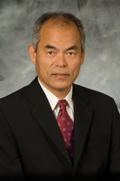

# Shuji Nakamura

**Born:** 22 May 1954

**Died / status:** Living (as of 2026-10-26)

**Fields:** Semiconductor physics, Optoelectronics

For the photographer or artist, date and type of image, consult the original image record.

## Biography

Shuji Nakamura was born in Ikata, Japan and conducted research in semiconductor physics and optoelectronics. Nobel records list University of California as the affiliation at the time of the award. They developed efficient blue light-emitting diodes. They were awarded the Nobel Prize in Physics in 2014.

## Major contributions to physics

- Developed efficient blue light-emitting diodes
- Enabled energy-efficient white lighting and related optoelectronic devices

**Nobel Prize in Physics:** 2014

## Image source and rights

- Source: [Original image record](https://commons.wikimedia.org/wiki/File:Shuji_Nakamura_Nobel.jpg)
- Creator / attribution: 文部科学省
- License or rights statement: [CC BY 4.0](https://commons.wikimedia.org/wiki/Commons:Non-copyright_restrictions)
- Local image: [3ebe42e4b90e12410495.jpg](../portraits/3ebe42e4b90e12410495.jpg)
- Credit: https://warp.ndl.go.jp/info:ndljp/pid/9493938/www.mext.go.jp/b_menu/daijin/detail/1353988.htm

## Sources

- [Shuji Nakamura - Facts](https://www.nobelprize.org/prizes/physics/2014/nakamura/facts/)
- [Nobel Prize official laureate API, id 908](https://api.nobelprize.org/2.1/laureate/908)
- [Wikipedia: Shuji Nakamura](https://en.wikipedia.org/wiki/Shuji_Nakamura)

Record reviewed: 2026-10-26.
