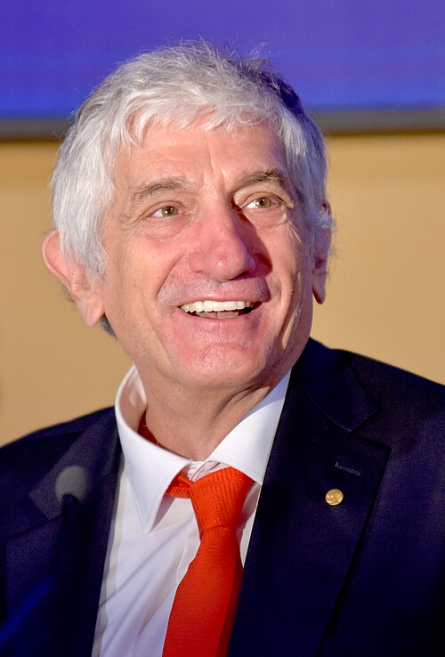

# John M. Martinis

**Born:** 1958

**Died / status:** Living (as of 2026-10-26)

**Fields:** Condensed-matter physics, Superconducting circuits, Quantum mechanics

For the photographer or artist, date and type of image, consult the original image record.

## Biography

John M. Martinis conducted research in condensed-matter physics, superconducting circuits and quantum mechanics. Nobel records list University of California and Qolab as the affiliations at the time of the award. They discovered macroscopic quantum tunnelling and energy quantization in electrical circuits. They were awarded the Nobel Prize in Physics in 2025.

## Major contributions to physics

- Discovered macroscopic quantum tunnelling and energy quantization in electrical circuits
- Established foundations for controllable quantum behaviour in superconducting circuits

**Nobel Prize in Physics:** 2025

## Historical and source notes

- The official Nobel structured source provides only the birth year, 1958; that precision is retained.

## Image source and rights

- Source: [Original image record](https://commons.wikimedia.org/wiki/File:John_M._Martinis%2C_American_physicst_and_2025_Nobel_laurate_in_physics.jpg)
- Creator / attribution: Karen Zhou
- License or rights statement: [CC BY-SA 4.0](https://commons.wikimedia.org/wiki/File:John_M._Martinis%2C_American_physicst_and_2025_Nobel_laurate_in_physics.jpg)
- Local image: [b22b8ddaa8d9a570f9ce.jpg](../portraits/b22b8ddaa8d9a570f9ce.jpg)
- Credit: Own work

## Sources

- [John M. Martinis - Facts](https://www.nobelprize.org/prizes/physics/2025/martinis/facts/)
- [Nobel Prize official laureate API, id 1052](https://api.nobelprize.org/2.1/laureate/1052)
- [Wikipedia: John M. Martinis](https://en.wikipedia.org/wiki/John_M._Martinis)

Record reviewed: 2026-10-26.
