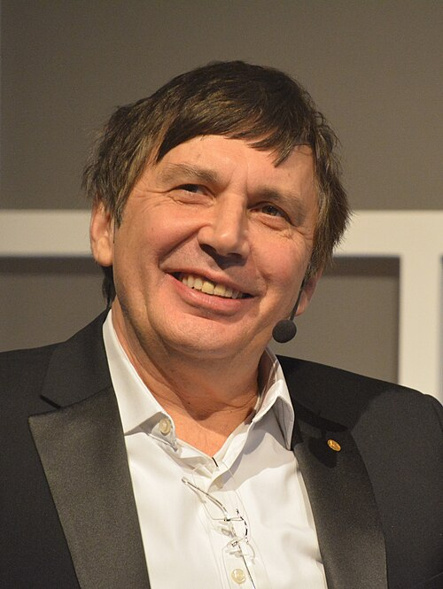

# Andre Geim

**Born:** 21 October 1958

**Died / status:** Living (as of 2026-10-26)

**Fields:** Condensed-matter physics, Two-dimensional materials

For the photographer or artist, date and type of image, consult the original image record.

## Biography

Andre Geim was born in Sochi, Russia and conducted research in condensed-matter physics and two-dimensional materials. Nobel records list University of Manchester as the affiliation at the time of the award. They isolated and experimentally investigated graphene. They were awarded the Nobel Prize in Physics in 2010.

## Major contributions to physics

- Isolated and experimentally investigated graphene
- Revealed distinctive electronic and quantum-transport properties of a two-dimensional carbon material

**Nobel Prize in Physics:** 2010

## Image source and rights

- Source: [Original image record](https://commons.wikimedia.org/wiki/File:Andre_Geim_10.jpg)
- Creator / attribution: Bengt Oberger
- License or rights statement: [CC BY-SA 4.0](https://creativecommons.org/licenses/by-sa/4.0)
- Local image: [209612bd600c6a61c552.jpg](../portraits/209612bd600c6a61c552.jpg)
- Credit: Own work

## Sources

- [Andre Geim - Facts](https://www.nobelprize.org/prizes/physics/2010/geim/facts/)
- [Nobel Prize official laureate API, id 849](https://api.nobelprize.org/2.1/laureate/849)
- [Wikipedia: Andre Geim](https://en.wikipedia.org/wiki/Andre_Geim)

Record reviewed: 2026-10-26.
