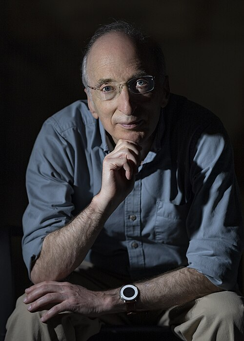

# Saul Perlmutter

**Born:** 1959

**Died / status:** Living (as of 2026-10-26)

**Fields:** Cosmology, Observational astronomy

For the photographer or artist, date and type of image, consult the original image record.

## Biography

Saul Perlmutter was born in Champaign-Urbana, IL, USA and conducted research in cosmology and observational astronomy. Nobel records list Lawrence Berkeley National Laboratory and University of California as the affiliations at the time of the award. They discovered the accelerating expansion of the universe through distant Type Ia supernovae. They were awarded the Nobel Prize in Physics in 2011.

## Major contributions to physics

- Discovered the accelerating expansion of the universe through distant Type Ia supernovae
- Provided crucial observational evidence motivating dark-energy research

**Nobel Prize in Physics:** 2011

## Historical and source notes

- The official Nobel structured source provides only the birth year, 1959. The date has not been given greater precision without independent evidence.

## Image source and rights

- Source: [Original image record](https://commons.wikimedia.org/wiki/File:Saul_Perlmutter_375e309_by_Christopher_Michel_8202024_01.jpg)
- Creator / attribution: Christopher Michel (1967–)
- License or rights statement: [CC BY-SA 4.0](https://commons.wikimedia.org/wiki/File:Saul_Perlmutter_375e309_by_Christopher_Michel_8202024_01.jpg)
- Local image: [ed37b454a1df13088e31.jpg](../portraits/ed37b454a1df13088e31.jpg)
- Credit: Own work

## Sources

- [Saul Perlmutter - Facts](https://www.nobelprize.org/prizes/physics/2011/perlmutter/facts/)
- [Nobel Prize official laureate API, id 864](https://api.nobelprize.org/2.1/laureate/864)
- [Wikipedia: Saul Perlmutter](https://en.wikipedia.org/wiki/Saul_Perlmutter)

Record reviewed: 2026-10-26.
