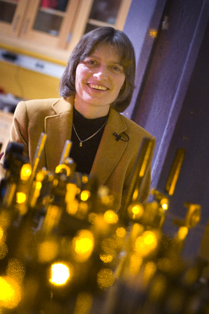

# Lene Hau

**Born:** 13 November 1959

**Died / status:** Living (as of 2026-10-26)

**Fields:** Atomic physics, Quantum optics

Sourced photograph or portrait; the image record identifies its creator, provenance, and reuse conditions.

## Biography

A Danish-born experimental physicist educated at Aarhus, Hau worked at the Rowland Institute and Harvard. She uses ultracold atoms to control light propagation and coherent exchanges between optical and material states.

## Major contributions to physics

- Greatly reduced light-pulse group velocities in a Bose–Einstein condensate.
- Stored and recovered optical-pulse information using electromagnetically induced transparency and related coherent mechanisms.
- Investigated ultracold atoms and quantum-coherent control.

## Image source and rights

- Source: [Original image record](https://commons.wikimedia.org/wiki/File:Professor_Lene_Hau_in_her_laboratory_at_Harvard.jpg)
- Creator / attribution: (Photo courtesy of Justin Ide/Harvard News Office)
- License or rights statement: Public domain
- Local image: [d4e8a2b461a5140a1a0d.jpg](../portraits/d4e8a2b461a5140a1a0d.jpg)
- Credit: http://www.wpafb.af.mil/news/story.asp?id=123133604

## Sources

- [Lene Hau — reference biography (en.wikipedia.org)](https://en.wikipedia.org/wiki/Lene_Hau)

Record reviewed: 2026-10-26.
