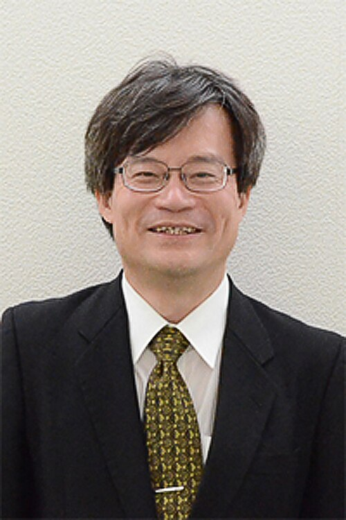

# Hiroshi Amano

**Born:** 11 September 1960

**Died / status:** Living (as of 2026-10-26)

**Fields:** Semiconductor physics, Optoelectronics

For the photographer or artist, date and type of image, consult the original image record.

## Biography

Hiroshi Amano was born in Hamamatsu, Japan and conducted research in semiconductor physics and optoelectronics. Nobel records list Nagoya University as the affiliation at the time of the award. They developed efficient blue light-emitting diodes. They were awarded the Nobel Prize in Physics in 2014.

## Major contributions to physics

- Developed efficient blue light-emitting diodes
- Enabled energy-efficient white lighting and related optoelectronic devices

**Nobel Prize in Physics:** 2014

## Image source and rights

- Source: [Original image record](https://commons.wikimedia.org/wiki/File:Hiroshi_Amano_20141211.jpg)
- Creator / attribution: 研究振興局振興企画課
- License or rights statement: [CC BY 4.0](https://creativecommons.org/licenses/by/4.0)
- Local image: [98046c934dd08e7f9967.jpg](../portraits/98046c934dd08e7f9967.jpg)
- Credit: Original credit is retained in the source record.

## Sources

- [Hiroshi Amano - Facts](https://www.nobelprize.org/prizes/physics/2014/amano/facts/)
- [Nobel Prize official laureate API, id 907](https://api.nobelprize.org/2.1/laureate/907)
- [Wikipedia: Hiroshi Amano](https://en.wikipedia.org/wiki/Hiroshi_Amano)

Record reviewed: 2026-10-26.
