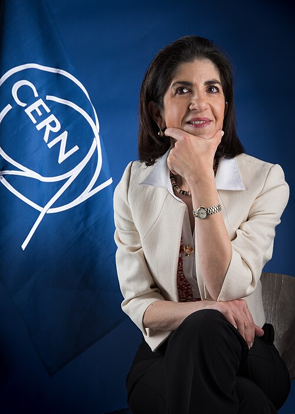

# Fabiola Gianotti

**Born:** 29 October 1960

**Died / status:** Living (as of 2026-10-26)

**Fields:** Experimental particle physics

Sourced photograph or portrait; the image record identifies its creator, provenance, and reuse conditions.

## Biography

An Italian experimental particle physicist with a Milan doctorate, Gianotti joined CERN and served as ATLAS spokesperson during the Higgs-discovery period. She subsequently became CERN's director-general, combining experimental work with leadership of international collaborations.

## Major contributions to physics

- Led and contributed to ATLAS detector development, analysis, and collaboration.
- Participated in the Higgs-boson discovery and property measurements.
- Advanced collider research and international scientific cooperation.

## Image source and rights

- Source: [Original image record](https://commons.wikimedia.org/wiki/File:Dr_Fabiola_Gianotti.jpg)
- Creator / attribution: Maximilien Brice
- License or rights statement: [CC BY 4.0](https://commons.wikimedia.org/wiki/File:Dr_Fabiola_Gianotti.jpg)
- Local image: [1455f4334fc4f9d06ccd.jpg](../portraits/1455f4334fc4f9d06ccd.jpg)
- Credit: CERN Document Server: https://cds.cern.ch/record/2116825

## Sources

- [Fabiola Gianotti — biographical or institutional source (home.cern)](https://home.cern/about/who-we-are/our-people/fabiola-gianotti/)
- [Fabiola Gianotti — reference biography (en.wikipedia.org)](https://en.wikipedia.org/wiki/Fabiola_Gianotti)

Record reviewed: 2026-10-26.
