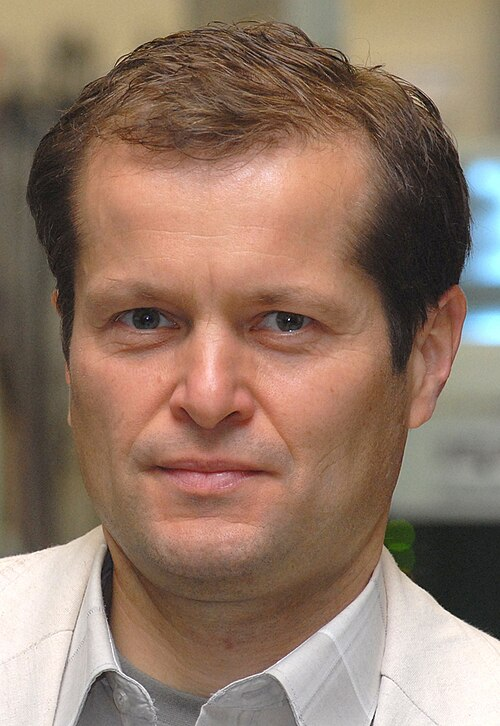

# Ferenc Krausz

**Born:** 17 May 1962

**Died / status:** Living (as of 2026-10-26)

**Fields:** Attosecond physics, Ultrafast optics

For the photographer or artist, date and type of image, consult the original image record.

## Biography

Ferenc Krausz was born in Mór, Hungary and conducted research in attosecond physics and ultrafast optics. Nobel records list Max Planck Institute of Quantum Optics and Ludwig-Maximilians-Universität München as the affiliations at the time of the award. They developed experimental methods for producing attosecond light pulses. They were awarded the Nobel Prize in Physics in 2023.

## Major contributions to physics

- Developed experimental methods for producing attosecond light pulses
- Made it possible to investigate ultrafast electron dynamics in matter

**Nobel Prize in Physics:** 2023

## Image source and rights

- Source: [Original image record](https://commons.wikimedia.org/wiki/File:Ferenc_Krausz_(cropped).jpg)
- Creator / attribution: Original uploaded by C.laschinger (Transfered by Syp)
- License or rights statement: [CC BY 2.0](https://creativecommons.org/licenses/by/2.0)
- Local image: [b921e46c68bfe130839b.jpg](../portraits/b921e46c68bfe130839b.jpg)
- Credit: Original uploaded on en.wikipedia

## Sources

- [Ferenc Krausz - Facts](https://www.nobelprize.org/prizes/physics/2023/krausz/facts/)
- [Nobel Prize official laureate API, id 1027](https://api.nobelprize.org/2.1/laureate/1027)
- [Wikipedia: Ferenc Krausz](https://en.wikipedia.org/wiki/Ferenc_Krausz)

Record reviewed: 2026-10-26.
