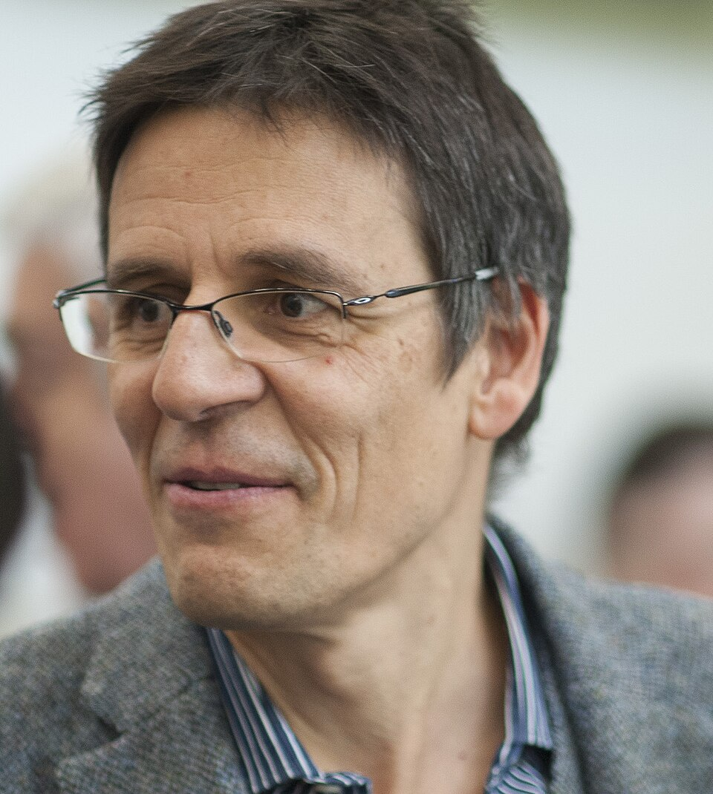

# Didier Queloz

**Born:** 23 February 1966

**Died / status:** Living (as of 2026-10-26)

**Fields:** Astrophysics, Exoplanets

For the photographer or artist, date and type of image, consult the original image record.

## Biography

Didier Queloz was born in Geneva, Switzerland and conducted research in astrophysics and exoplanets. Nobel records list University of Geneva and University of Cambridge as the affiliations at the time of the award. They discovered 51 Pegasi b with Michel Mayor through stellar radial-velocity measurements. They were awarded the Nobel Prize in Physics in 2019.

## Major contributions to physics

- Discovered 51 Pegasi b with Michel Mayor through stellar radial-velocity measurements
- Advanced the investigation of exoplanets orbiting ordinary stars

**Nobel Prize in Physics:** 2019

## Image source and rights

- Source: [Original image record](https://commons.wikimedia.org/wiki/File:Queloz_profile.jpg)
- Creator / attribution: Astrofisch66
- License or rights statement: [CC BY-SA 4.0](https://commons.wikimedia.org/wiki/File:Queloz_profile.jpg)
- Local image: [531cbfc9e151f8c6c2ad.jpg](../portraits/531cbfc9e151f8c6c2ad.jpg)
- Credit: Own work

## Sources

- [Didier Queloz - Facts](https://www.nobelprize.org/prizes/physics/2019/queloz/facts/)
- [Nobel Prize official laureate API, id 975](https://api.nobelprize.org/2.1/laureate/975)
- [Wikipedia: Didier Queloz](https://en.wikipedia.org/wiki/Didier_Queloz)

Record reviewed: 2026-10-26.
