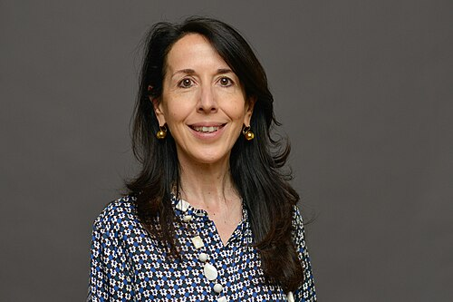

# Alessandra Buonanno

**Born:** 1968

**Died / status:** Living (as of 2026-10-26)

**Fields:** Gravitational waves, General relativity

Sourced portrait or photograph; see the image record for provenance and reuse conditions.

## Biography

An Italian-born theorist who worked in France and the United States, Buonanno became a director at the Max Planck Institute for Gravitational Physics. She connects analytical relativity, numerical modelling, and LIGO data analysis.

## Major contributions to physics

- Developed the effective-one-body approach with Damour.
- Developed waveforms for merging compact binaries.
- Applied precision waveforms to gravitational-wave detection and parameter inference.

## Historical and source notes

- The sources reviewed establish the birth year; an unverified month and day have not been added.

## Image source and rights

- Source: [Original image record](https://commons.wikimedia.org/wiki/File:Alessandra_Buonanno,_director_at_the_Max_Planck_Institute_for_Gravitational_Physics.jpg)
- Creator / attribution: Markus Scholz | https://marsfoto.de/
- License or rights statement: [CC BY-SA 4.0](https://creativecommons.org/licenses/by-sa/4.0)
- Local image: [657c37c309e27f7f6672-e143e46670.jpg](../portraits/657c37c309e27f7f6672-e143e46670.jpg)
- Credit: It was provided to us by the Leopoldina (German National Academy of Sciences: https://www.leopoldina.org/en/leopoldina-home/), the fotographer (Markus Scholz) has agreed to share this image.

## Sources

- [Alessandra Buonanno — reference biography (en.wikipedia.org)](https://en.wikipedia.org/wiki/Alessandra_Buonanno)
- [Alessandra Buonanno — institutional or scholarly source (www.ictp.it)](https://www.ictp.it/about-ictp/prizes-awards/the-dirac-medal/the-medallists/dirac-medallists-2021.aspx)
- [Alessandra Buonanno — institutional or scholarly source (www.aei.mpg.de)](https://www.aei.mpg.de/790105/alessandra-buonanno-receives-the-2022-tomalla-prize)
- [Alessandra Buonanno — institutional or scholarly source (www.ictp.it)](https://www.ictp.it/prize/dirac-medal)

Record reviewed: 2026-10-26.
