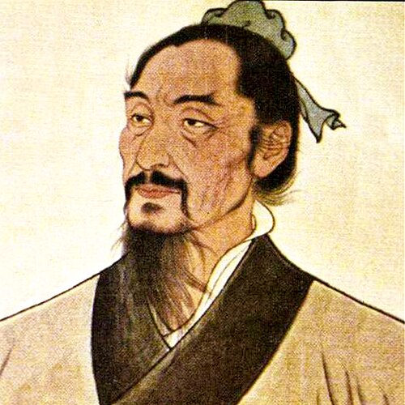

# 墨子

**英文名：** Mozi

**生卒：** 约公元前470年 — 约公元前391年

**主要领域：** 中国古代物理、光学史、力学史

古代或中世纪人物：此图为后世画像、雕像或传统形象，并非可核实的同时代写生肖像；请结合图片来源判断。

## 生平简介

中国战国时期思想家、墨家学派创立者，强调实用技艺和有根据的论证。传世《墨子》包含多个时代的材料，其中有关光学、力学与几何的《墨经》主要出自后期墨家，不能全部归为墨子本人所作。

## 对物理的主要贡献

- 其学派留下中国早期关于影、反射及小孔成像的讨论。
- 墨家文献讨论力、运动、平衡及空间等问题，是中国古代物理思想的重要史料。

## 史料说明

- 《墨经》光学和力学论述属于后期墨家集体成果，不应全部归为墨子本人。
- 出生与卒年存在不同推定，此处采用约公元前470—391年。

## 肖像来源与许可

- 来源：[Философ_Мо-Цзы.jpg](https://commons.wikimedia.org/wiki/File:%D0%A4%D0%B8%D0%BB%D0%BE%D1%81%D0%BE%D1%84_%D0%9C%D0%BE-%D0%A6%D0%B7%D1%8B.jpg)
- 作者／署名：Vjacheslav Rublevskiy
- 许可：[CC0](http://creativecommons.org/publicdomain/zero/1.0/deed.en)
- 本地文件：[8d4f0be283f19c21c600.jpg](../portraits/8d4f0be283f19c21c600.jpg)
- 原始来源说明：https://www.flickr.com/photos/193162016@N04/51221161306/

## 资料来源

- [Stanford Encyclopedia of Philosophy — Mohist Canons](https://plato.stanford.edu/entries/mohist-canons/)
- [Internet Encyclopedia of Philosophy — Mozi](https://iep.utm.edu/mozi/)
- [Wikipedia — Mozi](https://en.wikipedia.org/wiki/Mozi)

资料整理日期：2026-10-26。
