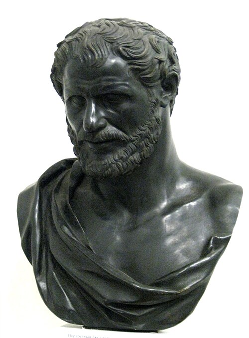

# 德谟克利特

**英文名：** Democritus

**生卒：** 约公元前460年 — 约公元前370年

**主要领域：** 原子论史、自然哲学

古代或中世纪人物：此图为后世画像、雕像或传统形象，并非可核实的同时代写生肖像；请结合图片来源判断。

## 生平简介

古希腊阿布德拉思想家，与留基伯共同发展原子论。他的著作大多失传，思想主要依靠后代引述重建。他提出物质由原子和虚空组成，属于自然哲学假说，尚不是建立在实验测量上的现代原子物理学。

## 对物理的主要贡献

- 以原子和虚空说明物质的组成及变化。
- 将物体的性质与微观构成和排列联系起来，为后世微粒观念提供历史资源。

## 史料说明

- 生卒年为传统约数；古代原子论不同于现代原子物理学。

## 肖像来源与许可

- 来源：[Unknown_greek_pushkin.jpg](https://commons.wikimedia.org/wiki/File:Unknown_greek_pushkin.jpg)
- 作者／署名：user:shakko
- 许可：[CC BY-SA 3.0](https://creativecommons.org/licenses/by-sa/3.0)
- 本地文件：[ed9bf929f6fd628f7a0f.jpg](../portraits/ed9bf929f6fd628f7a0f.jpg)
- 原始来源说明：Own work

## 资料来源

- [MacTutor History of Mathematics — Democritus](https://mathshistory.st-andrews.ac.uk/Biographies/Democritus/)
- [Wikipedia — Democritus](https://en.wikipedia.org/wiki/Democritus)

资料整理日期：2026-10-26。
