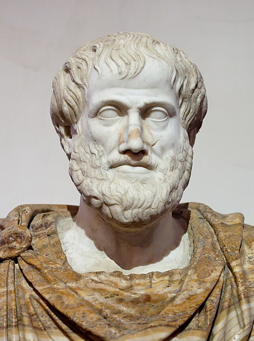

# 亚里士多德

**英文名：** Aristotle

**生卒：** 约公元前384年 — 约公元前322年

**主要领域：** 自然哲学、运动学史、宇宙学史

古代或中世纪人物：此图为后世画像、雕像或传统形象，并非可核实的同时代写生肖像；请结合图片来源判断。

## 生平简介

古希腊哲学家，曾在雅典求学，后创办吕克昂学园，并系统撰写有关自然、动物与逻辑的著作。他的物理学把运动、变化和原因纳入统一框架，对古代及中世纪学术产生深远影响，也成为近代科学反思的对象。

## 对物理的主要贡献

- 在《物理学》中系统讨论运动、时间、空间和因果解释。
- 建立地上与天界相区分的自然观，长期塑造欧洲和伊斯兰世界的自然哲学议题。

## 肖像来源与许可

- 来源：[Aristotle_Altemps_Inv8575.jpg](https://commons.wikimedia.org/wiki/File:Aristotle_Altemps_Inv8575.jpg)
- 作者／署名：After Lysippos
- 许可：Public domain
- 本地文件：[a90dfe4fb4d5e4a3c287.jpg](../portraits/a90dfe4fb4d5e4a3c287.jpg)
- 原始来源说明：Jastrow (2006)

## 资料来源

- [MacTutor History of Mathematics — Aristotle](https://mathshistory.st-andrews.ac.uk/Biographies/Aristotle/)
- [Wikipedia — Aristotle](https://en.wikipedia.org/wiki/Aristotle)

资料整理日期：2026-10-26。
