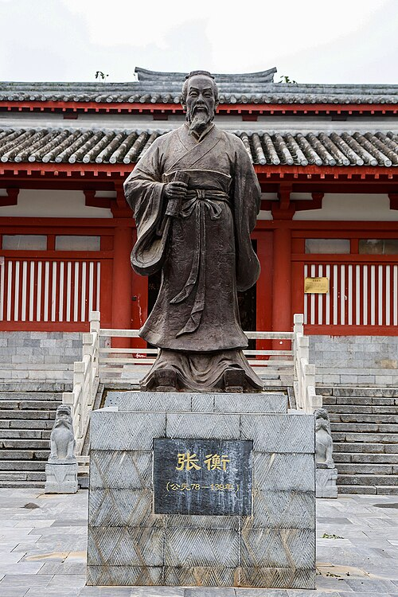

# 张衡

**英文名：** Zhang Heng

**生卒：** 78年 — 139年

**主要领域：** 中国古代物理、天文仪器、地震观测史

古代或中世纪人物：此图为后世画像、雕像或传统形象，并非可核实的同时代写生肖像；请结合图片来源判断。

## 生平简介

中国东汉科学家、文学家和官员，曾任太史令，研究天文历法并设计观测仪器。他将机械制作与天文观察结合，关于其候风地动仪的历史记载影响深远，但原器已失传，具体内部机构仍存在重建争论。

## 对物理的主要贡献

- 研制水力驱动浑天仪，将机械传动用于天象演示。
- 创制候风地动仪，尝试利用机械响应判别地震方向，是早期地震仪器史的重要节点。

## 史料说明

- 候风地动仪原器已失传，内部结构和现代复原方案存在争论。

## 肖像来源与许可

- 来源：[20251004_Tomb_of_Zhang_Heng_03.jpg](https://commons.wikimedia.org/wiki/File:20251004_Tomb_of_Zhang_Heng_03.jpg)
- 作者／署名：Windmemories
- 许可：[CC BY-SA 4.0](https://creativecommons.org/licenses/by-sa/4.0)
- 本地文件：[3bea8d46dff3a35ad464.jpg](../portraits/3bea8d46dff3a35ad464.jpg)
- 原始来源说明：Own work

## 资料来源

- [MacTutor History of Mathematics — Zhang Heng](https://mathshistory.st-andrews.ac.uk/Biographies/Zhang_Heng/)
- [Wikipedia — Zhang Heng](https://en.wikipedia.org/wiki/Zhang_Heng)

资料整理日期：2026-10-26。
