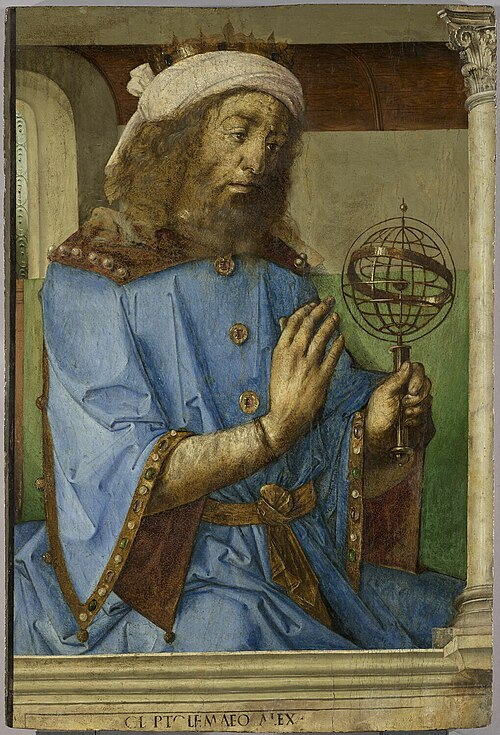

# 托勒密

**英文名：** Ptolemy

**生卒：** 约85—100年 — 约165—170年

**主要领域：** 天文学、几何光学

古代或中世纪人物：此图为后世画像、雕像或传统形象，并非可核实的同时代写生肖像；请结合图片来源判断。

## 生平简介

罗马统治时期活动于亚历山大里亚的天文学家、地理学家和光学作者。他以《天文学大成》整理地心天文学，相关模型长期用于推算天体位置；其《光学》保存了视觉、反射和折射的定量研究。

## 对物理的主要贡献

- 建立并系统整理本轮、偏心圆等行星位置计算模型。
- 通过实验数据讨论反射和折射，推动古代几何光学的发展。

## 史料说明

- 不同来源给出约85或100年出生、约165或170年去世，此处保留区间。

## 肖像来源与许可

- 来源：[Ptolemy_1476_with_armillary_sphere_model.jpg](https://commons.wikimedia.org/wiki/File:Ptolemy_1476_with_armillary_sphere_model.jpg)
- 作者／署名：Justus van Gent (fl. 1460–1480)
- 许可：[Public domain](https://commons.wikimedia.org/wiki/File:Ptolemy_1476_with_armillary_sphere_model.jpg)
- 本地文件：[4516dd9b753693ae4de3.jpg](../portraits/4516dd9b753693ae4de3.jpg)
- 原始来源说明：Public domainPublic domainfalsefalse

## 资料来源

- [MacTutor History of Mathematics — Ptolemy](https://mathshistory.st-andrews.ac.uk/Biographies/Ptolemy/)
- [Wikipedia — Ptolemy](https://en.wikipedia.org/wiki/Ptolemy)

资料整理日期：2026-10-26。
