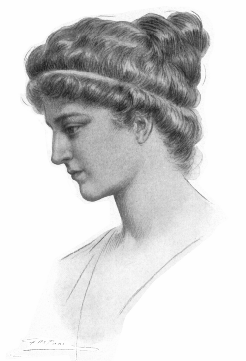

# 希帕蒂娅

**英文名：** Hypatia

**生卒：** 约355—370年 — 415年3月

**主要领域：** 天文学、数学物理史

儒勒·莫里斯·加斯帕尔为1908年出版物绘制的希帕提娅想象像，距本人生活年代约1500年，不是古代真实相貌记录。

## 生平简介

古代亚历山大里亚的数学家、天文学教师和新柏拉图主义哲学家，父亲为学者泰翁。她讲授数学与哲学，参与天文学知识的传承；其作品归属及生平细节多依后世记录重建，415年被暴民杀害。

## 对物理的主要贡献

- 教授并传播与天文学计算有关的数学知识。
- 其学术圈的书信留下星盘及比重计等仪器知识的记录，但不能将这些仪器的发明归于她。

## 史料说明

- 出生年通常估为约355年或370年；卒于415年3月，未把某一日当作确证日期。
- 不能据学生书信把星盘或比重计的发明权归给希帕蒂娅。

## 肖像来源与许可

- 来源：[audit-early-998b9928c094.png](https://commons.wikimedia.org/wiki/File:Hypatia_portrait.png)
- 作者／署名：Jules Maurice Gaspard
- 许可：[Public domain, as recorded by Wikimedia Commons](https://creativecommons.org/publicdomain/mark/1.0/)
- 本地文件：[998b9928c094c73bb5b4-feeb17668c.png](../portraits/998b9928c094c73bb5b4-feeb17668c.png)
- 原始来源说明：Jules Maurice Gaspard

## 资料来源

- [MacTutor History of Mathematics — Hypatia](https://mathshistory.st-andrews.ac.uk/Biographies/Hypatia/)
- [Wikipedia — Hypatia](https://en.wikipedia.org/wiki/Hypatia)

资料整理日期：2026-10-26。
