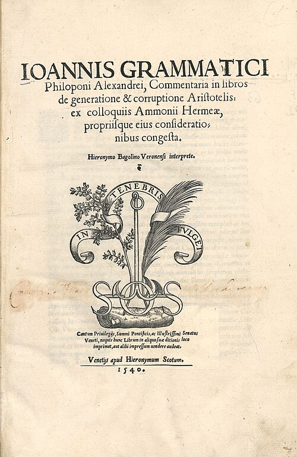

# 约翰·斐洛波努斯

**英文名：** John Philoponus

**生卒：** 约490年 — 约570年

**主要领域：** 运动理论史、自然哲学

未取得可核实的人物肖像。此图为斐洛波努斯《论生成与消灭》评注1540年印本扉页（BEIC馆藏），属于著作图像，不是人物肖像。

## 生平简介

晚期古代亚历山大里亚的哲学家和亚里士多德注释者，曾受教于阿摩尼奥斯。他批评传统运动和宇宙理论，以论证和经验观察质疑权威，其作品经叙利亚语、阿拉伯语及拉丁语传统影响后世自然哲学。

## 对物理的主要贡献

- 批评抛体运动必须靠周围介质持续推动的解释，提出获得的运动能力。
- 质疑落体速度严格正比于重量，并讨论真空中运动的可能性。

## 史料说明

- 生卒年为约数；其获得的运动能力等概念并非现代动量或牛顿惯性定律。

## 肖像来源与许可

- 来源：[audit-early-4458aa5d0808.jpg](https://commons.wikimedia.org/wiki/File:Ioannes_Philoponus_%E2%80%93_Commentaria_De_generatione_et_corruptione%2C_1540_%E2%80%93_BEIC_IE9022374.jpg)
- 作者／署名：John Philoponus / BEIC
- 许可：[Public domain, as recorded by Wikimedia Commons](https://creativecommons.org/publicdomain/mark/1.0/)
- 本地文件：[4458aa5d08086e502494-e1a40de8df.jpg](../portraits/4458aa5d08086e502494-e1a40de8df.jpg)
- 原始来源说明：John Philoponus / BEIC

## 资料来源

- [Stanford Encyclopedia of Philosophy — John Philoponus](https://plato.stanford.edu/entries/philoponus/)
- [Wikipedia — John Philoponus](https://en.wikipedia.org/wiki/John_Philoponus)

资料整理日期：2026-10-26。
