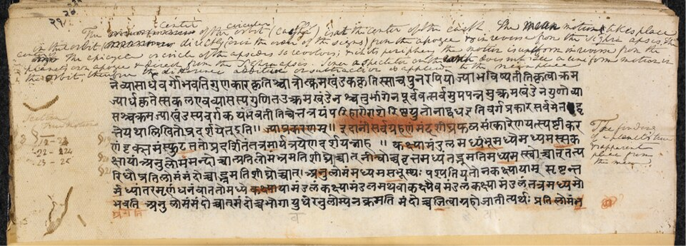

# 婆罗摩笈多

**英文名：** Brahmagupta

**生卒：** 598年 — 约668—670年

**主要领域：** 数学天文学、天文测量

未取得可核实的同时代肖像。此图为与婆罗摩笈多《梵天明悉檀多》及普利图达卡评注有关的手稿图页，英国图书馆藏号IO San 1304；不是作者肖像或本人亲笔，图像记录对抄本年代的表述不一致，故不据此断定年代。

## 生平简介

印度数学家和天文学家，曾在乌贾因学术传统中工作，628年撰写《婆罗摩修正体系》。除数论和算法外，他系统讨论天体计算、日月食与观测仪器，把数学方法用于实际天文问题；卒年仅有约数。

## 对物理的主要贡献

- 发展天体经度、日月食和会合等现象的计算方法。
- 研究球面天文及仪器观测问题，扩充印度定量天文学传统。

## 史料说明

- 出生年通常记598年；卒年有668或670等约数说法。

## 肖像来源与许可

- 来源：[audit-early-8bd0c6368779.jpg](https://commons.wikimedia.org/wiki/File:P%E1%B9%9Bth%C5%ABdhaka%E2%80%99s_10th_century_commentary_on_Brahmagupta%E2%80%99s_Br%C4%81hmasphu%E1%B9%ADasiddh%C4%81nta.jpg)
- 作者／署名：British Library, IO San 1304 / Pṛthūdhaka and Brahmagupta
- 许可：[Public domain, as recorded by Wikimedia Commons](https://creativecommons.org/publicdomain/mark/1.0/)
- 本地文件：[8bd0c63687791b72130d-65e720378b.jpg](../portraits/8bd0c63687791b72130d-65e720378b.jpg)
- 原始来源说明：British Library, IO San 1304 / Pṛthūdhaka and Brahmagupta

## 资料来源

- [MacTutor History of Mathematics — Brahmagupta](https://mathshistory.st-andrews.ac.uk/Biographies/Brahmagupta/)
- [Wikipedia — Brahmagupta](https://en.wikipedia.org/wiki/Brahmagupta)

资料整理日期：2026-10-26。
