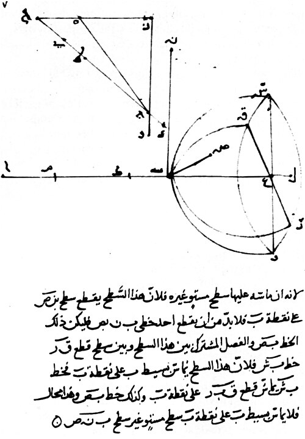

# 伊本·萨赫勒

**英文名：** Ibn Sahl

**生卒：** 约940年 — 约1000年

**主要领域：** 几何光学、折射

伊本·萨赫勒光学论著手稿（德黑兰Milli MS 867，第7r叶），展示折射与透镜几何；此图为相关文献，不是人物肖像。

## 生平简介

十世纪在巴格达活动的数学家与光学研究者，生平资料稀少，其出生地和文化身份不能确证。他约在984年撰写燃烧仪器论著，通过几何构造研究反射镜和透镜，相关手稿经现代科学史研究重新获得重视。

## 对物理的主要贡献

- 在透镜设计中使用等价于正弦折射定律的几何关系。
- 分析曲面镜和透镜的聚焦条件，构造减少几何像差的透镜形状。

## 史料说明

- 确切生卒年、出生地与宗教身份无法确定；此处年代为常用约数。
- 无已知可靠本人生前肖像；本档配图为光学手稿图页，不是本人肖像。

## 肖像来源与许可

- 来源：[Ibn Sahl manuscript.jpg](https://commons.wikimedia.org/wiki/File:Ibn_Sahl_manuscript.jpg)
- 作者／署名：Ibn Sahl (Abu Sa`d al-`Ala' ibn Sahl) (c. 940-1000)
- 许可：Public domain
- 本地文件：[ec26de39cf79c54d58b1-bd0807208c.jpg](../portraits/ec26de39cf79c54d58b1-bd0807208c.jpg)
- 原始来源说明：Milli MS 867, fol. 7r, Milli Library, Tehran

## 资料来源

- [European Physical Society — Europhysics News 51/3 (2020), history of optics](https://www.europhysicsnews.org/articles/epn/pdf/2020/03/epn2020-51-3.pdf)
- [Wikipedia — Ibn Sahl (mathematician)](https://en.wikipedia.org/wiki/Ibn_Sahl_(mathematician))

资料整理日期：2026-10-26。
