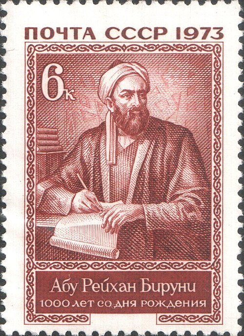

# 比鲁尼

**英文名：** Al-Biruni

**生卒：** 约973年 — 约1048年或1050年以后

**主要领域：** 测量物理、流体静力学、天文学

古代或中世纪人物：此图为后世画像、雕像或传统形象，并非可核实的同时代写生肖像；请结合图片来源判断。

## 生平简介

花剌子模出身的博学家，研究天文、地理、数学及自然现象，后在伽色尼活动，并著述介绍印度学术文化。他善于把观测、仪器和数学计算结合，用测量而非单纯思辨处理地球和材料的性质。

## 对物理的主要贡献

- 用几何与角度测量估算地球半径。
- 开展矿物和液体比重测定，研究流体静力学及相关精密测量方法。

## 史料说明

- 出生日期常记973年9月4日，MacTutor记9月15日，专业研究指出证据有限；卒年有1048年、约1050年或1050年以后等不同考证，故不将某一天视为无争议确日。

## 肖像来源与许可

- 来源：[Biruni-russian.jpg](https://commons.wikimedia.org/wiki/File:Biruni-russian.jpg)
- 作者／署名：The original uploader was Romanm at Slovenian Wikipedia.
- 许可：Public domain
- 本地文件：[e3a3b25a5bc888dc35c8.jpg](../portraits/e3a3b25a5bc888dc35c8.jpg)
- 原始来源说明：Originally from sl.wikipedia; description page is/was here.

## 资料来源

- [MacTutor History of Mathematics — Al-Biruni](https://mathshistory.st-andrews.ac.uk/Biographies/Al-Biruni/)
- [Wikipedia — Al-Biruni](https://en.wikipedia.org/wiki/Al-Biruni)
- [George Saliba, Cambridge History — Al-Biruni and the sciences of his time](https://www.cambridge.org/core/books/abs/religion-learning-and-science-in-the-abbasid-period/albiruni-and-the-sciences-of-his-time/311B9E191252A89AC266F6F1687FA0E9)
- [Encyclopaedia Iranica — Biruni, Life](https://www.iranicaonline.org/articles/biruni-abu-rayhan-index/biruni-abu-rayhan-i-life/)
- [McGill / Springer Biographical Encyclopedia of Astronomers — Biruni](https://www.islamsci.mcgill.ca/RASI/BEA/Biruni_BEA.htm)

资料整理日期：2026-10-26。
