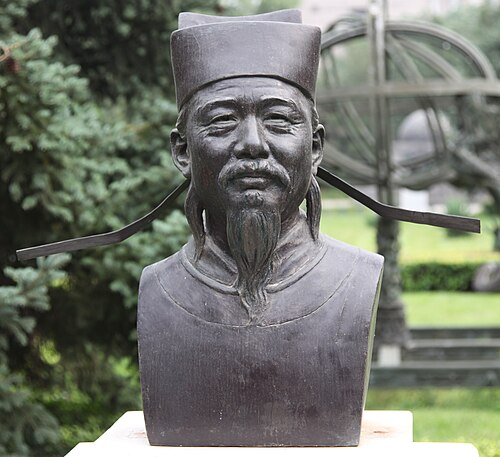

# 沈括

**英文名：** Shen Kuo

**生卒：** 1031年 — 1095年

**主要领域：** 中国古代物理、磁学、光学

古代或中世纪人物：此图为后世画像、雕像或传统形象，并非可核实的同时代写生肖像；请结合图片来源判断。

## 生平简介

中国北宋科学家与官员，曾参与天文历法、工程和军事事务，晚年整理《梦溪笔谈》。该书记录大量观察、实验与技术见闻，涵盖天文、磁学、光学和地质，是认识宋代自然科学的重要史料。

## 对物理的主要贡献

- 记录磁针的制作与使用，并指出磁北方向与正北之间的偏差。
- 讨论小孔成像、凹面镜等光学现象，重视观察与几何解释的结合。

## 肖像来源与许可

- 来源：[Beijing_Ancient_Observatory_20090715-19_(cropped).jpg](https://commons.wikimedia.org/wiki/File:Beijing_Ancient_Observatory_20090715-19_(cropped).jpg)
- 作者／署名：Hans A. Rosbach
- 许可：[CC BY-SA 3.0](https://creativecommons.org/licenses/by-sa/3.0)
- 本地文件：[9147f1a1bc44d9f8844d.jpg](../portraits/9147f1a1bc44d9f8844d.jpg)
- 原始来源说明：Own work

## 资料来源

- [MacTutor History of Mathematics — Shen Kuo](https://mathshistory.st-andrews.ac.uk/Biographies/Shen_Kua/)
- [Wikipedia — Shen Kuo](https://en.wikipedia.org/wiki/Shen_Kuo)

资料整理日期：2026-10-26。
