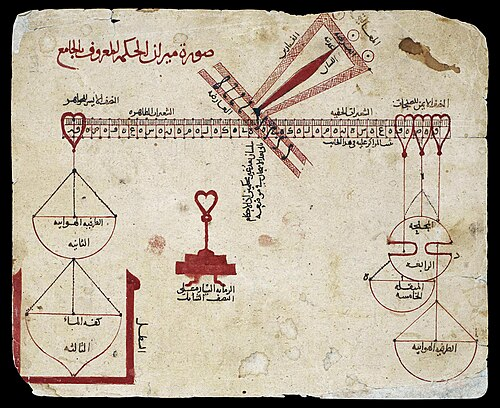

# 哈齐尼

**英文名：** Al-Khazini

**生卒：** 约1077年 — 约1130年

**主要领域：** 流体静力学、计量学、机械学

此图已经目视核对，内容为天平装置示意，不含人物。它来自约1270年抄写的哈齐尼《智慧天平书》阿拉伯文手稿，宾夕法尼亚大学LJS386，fol.80v，属于著作与仪器图像，不能标为肖像。

## 生平简介

十二世纪活动于木鹿的天文学家和机械学研究者，受到塞尔柱统治者桑贾尔的支持。其生卒年缺少确切记载，主要活动期在十二世纪前期。《智慧之秤》系统讨论称量仪器、比重与流体平衡。

## 对物理的主要贡献

- 整理并发展流体静力称量方法，测量物质比重。
- 设计和分析精密复合天平，将平衡、重心与仪器误差纳入研究。

## 史料说明

- 确切生卒年不详；约1077—1130年为常见推定，主要有据活动期约1115—1130年。
- 无已知可靠本人生前肖像。

## 肖像来源与许可

- 来源：[University of Pennsylvania MS Lawrence J. Schoenberg Collection 386 fol. 80v al-Khazini's Balance.jpg](https://commons.wikimedia.org/wiki/File:University_of_Pennsylvania_MS_Lawrence_J._Schoenberg_Collection_386_fol._80v_al-Khazini%27s_Balance.jpg)
- 作者／署名：Unknown author
- 许可：[Public domain](https://creativecommons.org/publicdomain/mark/1.0/)
- 本地文件：[13dae8a543f80e31d4d6-0a43b1f5a3.jpg](../portraits/13dae8a543f80e31d4d6-0a43b1f5a3.jpg)
- 原始来源说明：https://openn.library.upenn.edu/Data/0001/html/ljs386.html

## 资料来源

- [Al-Khazini’s Balance of Wisdom — Nuncius (2021)](https://brill.com/abstract/journals/nun/36/1/article-p49_3.xml?language=en)
- [Wikipedia — Al-Khazini](https://en.wikipedia.org/wiki/Al-Khazini)

资料整理日期：2026-10-26。
