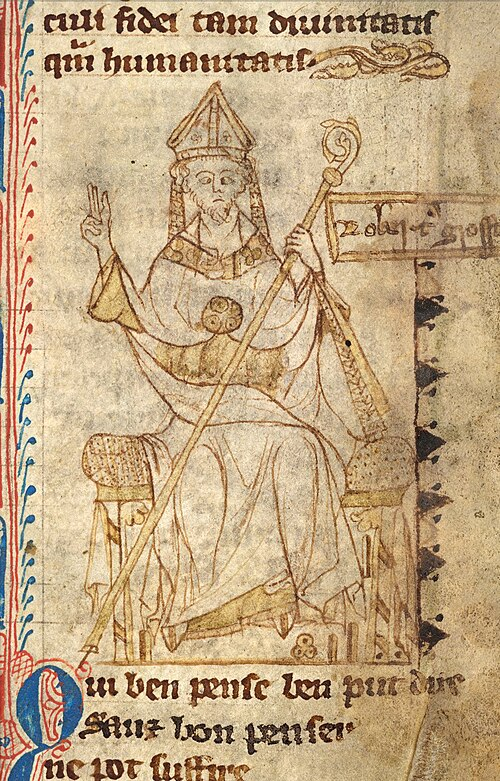

# 罗伯特·格罗斯泰斯特

**英文名：** Robert Grosseteste

**生卒：** 约1168—1175年 — 1253年10月9日

**主要领域：** 光学史、自然哲学

古代或中世纪人物：此图为后世画像、雕像或传统形象，并非可核实的同时代写生肖像；请结合图片来源判断。

## 生平简介

英国中世纪学者，曾在牛津学术圈活动，后任林肯主教。他翻译希腊著作并研究自然哲学，主张几何对于认识自然的重要性，以光、颜色和虹等问题连接自然哲学与数学推理。

## 对物理的主要贡献

- 在《论光》等著作中尝试以光解释自然结构。
- 研究反射、折射及虹，强调几何方法在自然研究中的作用。

## 史料说明

- 出生年来源有约1168、1170及1175等不同推定。

## 肖像来源与许可

- 来源：[Grosseteste_bishop.jpg](https://commons.wikimedia.org/wiki/File:Grosseteste_bishop.jpg)
- 作者／署名：Unknown 14th century scribe
- 许可：Public domain
- 本地文件：[f20a1d0e63d17dc2b317.jpg](../portraits/f20a1d0e63d17dc2b317.jpg)
- 原始来源说明：British Library Harley MS 3860, f. 48 Original version adapted from: dead link New version adapted from: dead link; current link

## 资料来源

- [MacTutor History of Mathematics — Robert Grosseteste](https://mathshistory.st-andrews.ac.uk/Biographies/Grosseteste/)
- [Wikipedia — Robert Grosseteste](https://en.wikipedia.org/wiki/Robert_Grosseteste)

资料整理日期：2026-10-26。
