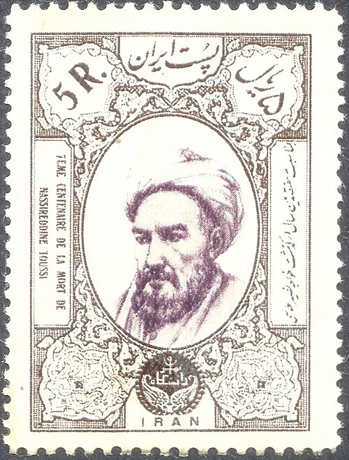

# 纳西尔丁·图西

**英文名：** Nasir al-Din al-Tusi

**生卒：** 1201年2月18日 — 1274年6月26日

**主要领域：** 数学天文学、天体运动模型

古代或中世纪人物：此图为后世画像、雕像或传统形象，并非可核实的同时代写生肖像；请结合图片来源判断。

## 生平简介

十三世纪伊朗数学家和天文学家，先后在不同统治者支持下工作，组织建立马拉盖天文台。他参与天文观测和历表编制，并以几何模型改进托勒密天文学，是中世纪天体运动模型发展的重要人物。

## 对物理的主要贡献

- 提出由两个匀速圆周运动合成直线往复运动的图西双圆构造。
- 组织马拉盖天文台观测和历表工作，并改进球面三角学在天文学中的应用。

## 肖像来源与许可

- 来源：[Nasir_al-Din_Tusi.jpg](https://commons.wikimedia.org/wiki/File:Nasir_al-Din_Tusi.jpg)
- 作者／署名：见原图页面
- 许可：Public domain
- 本地文件：[e9887e7f6efd9f3a30ea-b13d4ccf47.jpg](../portraits/e9887e7f6efd9f3a30ea-b13d4ccf47.jpg)
- 原始来源说明：scan of stamp 30 May 2006

## 资料来源

- [MacTutor History of Mathematics — Nasir al-Din al-Tusi](https://mathshistory.st-andrews.ac.uk/Biographies/Al-Tusi_Nasir/)
- [Wikipedia — Nasir al-Din al-Tusi](https://en.wikipedia.org/wiki/Nasir_al-Din_al-Tusi)

资料整理日期：2026-10-26。
