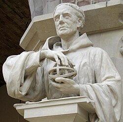

# 罗杰·培根

**英文名：** Roger Bacon

**生卒：** 约1214年 — 约1292年

**主要领域：** 光学史、实验方法史

古代或中世纪人物：此图为后世画像、雕像或传统形象，并非可核实的同时代写生肖像；请结合图片来源判断。

## 生平简介

英国方济各会学者，曾在牛津和巴黎学习与讲学。他广泛吸收阿拉伯语和希腊科学成果，在《大著作》等作品中强调数学、语言与经验研究；其光学研究是中世纪视觉科学传播的重要部分。

## 对物理的主要贡献

- 运用几何分析视觉、反射与折射，传播伊本·海赛姆的光学传统。
- 强调经验检验和数学对于自然知识的价值，并讨论透镜及光学装置。

## 史料说明

- 出生年不确切；此处采用MacTutor的约1214年。

## 肖像来源与许可

- 来源：[Roger-bacon-statue.jpg](https://commons.wikimedia.org/wiki/File:Roger-bacon-statue.jpg)
- 作者／署名：见原图页面
- 许可：[GFDL](https://en.wikipedia.org/wiki/en:Creative_Commons)
- 本地文件：[9ad8a09cf56d35e34d82.jpg](../portraits/9ad8a09cf56d35e34d82.jpg)

## 资料来源

- [MacTutor History of Mathematics — Roger Bacon](https://mathshistory.st-andrews.ac.uk/Biographies/Bacon/)
- [Wikipedia — Roger Bacon](https://en.wikipedia.org/wiki/Roger_Bacon)

资料整理日期：2026-10-26。
