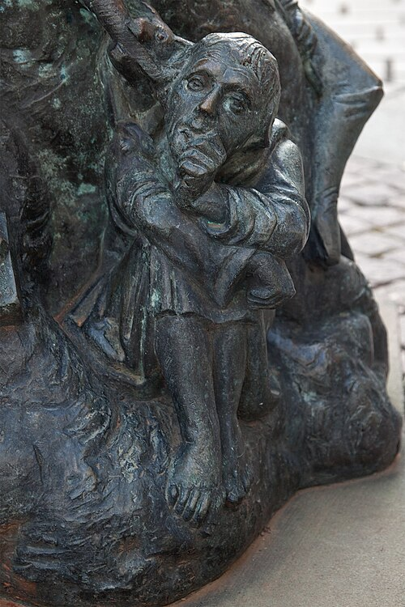

# 弗赖贝格的狄奥多里克

**英文名：** Theodoric of Freiberg

**生卒：** 约1250年 — 1310年以后，确年不详

**主要领域：** 几何光学、虹的物理

德国弗赖贝格福尔图娜喷泉上表现狄奥多里克的后世雕塑细部，Unukorno摄于2012年。是纪念性人物塑像，不是经核实的中世纪面貌记录。

## 生平简介

狄奥多里克又称迪特里希，是德意志道明会学者，曾在巴黎求学并承担修会职务。他研究认识论、自然哲学和光学，以实验与几何讨论虹，其确切出生和死亡年份均未确证。

## 对物理的主要贡献

- 利用盛水玻璃球等模型分析光线，解释主虹和副虹中的折射与内部反射。
- 把单个水滴中的光路与观察者看到的整体虹联系起来，推进虹的定量解释。

## 史料说明

- 确切生卒年不详；出生约1250年，1310年后仍可能在世。

## 肖像来源与许可

- 来源：[audit-early-5beb376782d3.jpg](https://commons.wikimedia.org/wiki/File:Fortunabrunnen_Freiberg_Dietrich_von_Freiberg.jpg)
- 作者／署名：Unukorno (photograph)
- 许可：[CC BY-SA 3.0](https://creativecommons.org/licenses/by-sa/3.0/)
- 本地文件：[5beb376782d3087bf94b-c6f3679818.jpg](../portraits/5beb376782d3087bf94b-c6f3679818.jpg)
- 原始来源说明：Unukorno (photograph)

## 资料来源

- [Stanford Encyclopedia of Philosophy — Dietrich of Freiberg](https://plato.stanford.edu/entries/dietrich-freiberg/)
- [Wikipedia — Theodoric of Freiberg](https://en.wikipedia.org/wiki/Theodoric_of_Freiberg)

资料整理日期：2026-10-26。
