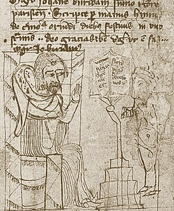

# 让·布里丹

**英文名：** Jean Buridan

**生卒：** 约1300年 — 约1358—1361年之间

**主要领域：** 运动理论史、自然哲学

古代或中世纪人物：此图为后世画像、雕像或传统形象，并非可核实的同时代写生肖像；请结合图片来源判断。

## 生平简介

十四世纪法国经院哲学家，长期任教巴黎大学，曾两度担任校长。他在亚里士多德传统内部讨论自然问题，以“冲力”解释抛体离手后的运动，构成中世纪运动理论的重要发展；生卒年仅能大致确定。

## 对物理的主要贡献

- 发展并传播冲力理论，把抛体的持续运动与获得的内部动力联系起来。
- 讨论冲力与物质量、速度及阻力的关系，为后续运动理论留下重要问题。

## 史料说明

- 斯坦福百科记其1358年仍在世，1361年教产已转授他人；卒年用约数和区间表示。

## 肖像来源与许可

- 来源：[Iohannes_Buridanus_(Paris_ca._1370,_Kraków_cod._BJ_1771,_fol._142v).jpg](https://commons.wikimedia.org/wiki/File:Iohannes_Buridanus_(Paris_ca._1370,_Krak%C3%B3w_cod._BJ_1771,_fol._142v).jpg)
- 作者／署名：Unknown author
- 许可：Public domain
- 本地文件：[896d7036f4bc61f0f9b0.jpg](../portraits/896d7036f4bc61f0f9b0.jpg)
- 原始来源说明：https://www.hs-augsburg.de/~harsch/Chronologia/Lspost14/Buridanus/bur_intr.html

## 资料来源

- [Stanford Encyclopedia of Philosophy — John Buridan](https://plato.stanford.edu/entries/buridan/)
- [Wikipedia — Jean Buridan](https://en.wikipedia.org/wiki/Jean_Buridan)

资料整理日期：2026-10-26。
