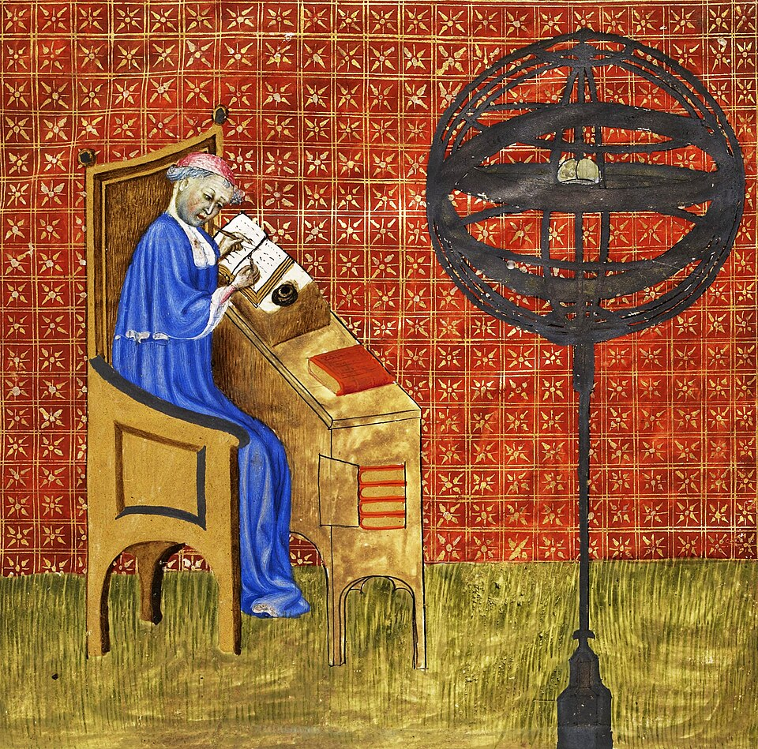

# 尼科尔·奥雷姆

**英文名：** Nicole Oresme

**生卒：** 约1320—1325年 — 1382年7月11日

**主要领域：** 运动学史、数学物理、宇宙学史

古代或中世纪人物：此图为后世画像、雕像或传统形象，并非可核实的同时代写生肖像；请结合图片来源判断。

## 生平简介

法国中世纪学者、巴黎大学教师，后任利雪主教。他同时研究数学、经济和自然哲学，翻译亚里士多德著作，并以几何图形讨论强度和运动的变化；这些工作成为近代运动学之前的重要思想资源。

## 对物理的主要贡献

- 用图形表示随位置或时间变化的量，研究匀变运动与平均速度关系。
- 讨论地球自转的可能性，并研究光及视觉问题。

## 史料说明

- 出生年有约1320、1322、1323等说法，采用约1320—1325年范围。

## 肖像来源与许可

- 来源：[Oresme.jpg](https://commons.wikimedia.org/wiki/File:Oresme.jpg)
- 作者／署名：Nicole Oresme (1320–1382)
- 许可：[Public domain](https://commons.wikimedia.org/wiki/Commons:Reuse_of_PD-Art_photographs)
- 本地文件：[9d28ace333a0038962f6.jpg](../portraits/9d28ace333a0038962f6.jpg)
- 原始来源说明：Nicole Oresme (1400-1420) Traité de la sphère; Aristote, De caelo et de mundo, traduction française par Nicole Oresme, p. 1r OCLC: 1177977521.

## 资料来源

- [MacTutor History of Mathematics — Nicole Oresme](https://mathshistory.st-andrews.ac.uk/Biographies/Oresme/)
- [Bibliothèque nationale de France — Nicole Oresme authority record](https://catalogue.bnf.fr/ark%3A/12148/cb119181813)
- [Wikipedia — Nicole Oresme](https://en.wikipedia.org/wiki/Nicole_Oresme)

资料整理日期：2026-10-26。
