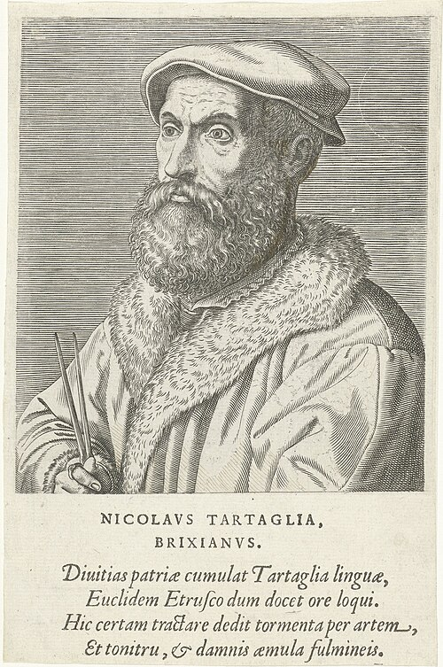

# 尼科洛·塔尔塔利亚

**英文名：** Niccolò Tartaglia

**生卒：** 约1499—1500年 — 1557年12月13日

**主要领域：** 弹道学史、应用力学

肖像的作者、拍摄或创作年代及具体形式见图片来源。

## 生平简介

文艺复兴时期意大利数学家，少年在战争中受伤，主要靠自学并以教学为生。他因三次方程研究知名，也将数学用于炮术、测量和军事技术，其《新科学》是早期弹道学的重要著作。

## 对物理的主要贡献

- 把抛射运动和炮术问题引入系统的数学研究。
- 讨论射角与射程关系，推动经验炮术向定量弹道学发展。

## 史料说明

- 出生年不同来源记1499或1500，无法确到日。

## 肖像来源与许可

- 来源：[Portret_van_Niccolo_Tartaglia_Nicolavs_Tartaglia_Brixianvs_(titel_op_object)_Portretten_van_beroemde_Europese_geleerden_(serietitel)_Virorum_doctorum_de_Disciplinis_benemerentium_effigies_(serietitel),_RP-P-1909-4459.jpg](https://commons.wikimedia.org/wiki/File:Portret_van_Niccolo_Tartaglia_Nicolavs_Tartaglia_Brixianvs_%28titel_op_object%29_Portretten_van_beroemde_Europese_geleerden_%28serietitel%29_Virorum_doctorum_de_Disciplinis_benemerentium_effigies_%28serietitel%29%2C_RP-P-1909-4459.jpg)
- 作者／署名：Rijksmuseum
- 许可：[CC0](https://commons.wikimedia.org/wiki/File:Portret_van_Niccolo_Tartaglia_Nicolavs_Tartaglia_Brixianvs_%28titel_op_object%29_Portretten_van_beroemde_Europese_geleerden_%28serietitel%29_Virorum_doctorum_de_Disciplinis_benemerentium_effigies_%28serietitel%29%2C_RP-P-1909-4459.jpg)
- 本地文件：[b4792e66cc83e1162710.jpg](../portraits/b4792e66cc83e1162710.jpg)
- 原始来源说明：http://hdl.handle.net/10934/RM0001.COLLECT.115228

## 资料来源

- [MacTutor History of Mathematics — Niccolò Tartaglia](https://mathshistory.st-andrews.ac.uk/Biographies/Tartaglia/)
- [Wikipedia — Niccolò Tartaglia](https://en.wikipedia.org/wiki/Niccol%C3%B2_Tartaglia)

资料整理日期：2026-10-26。
