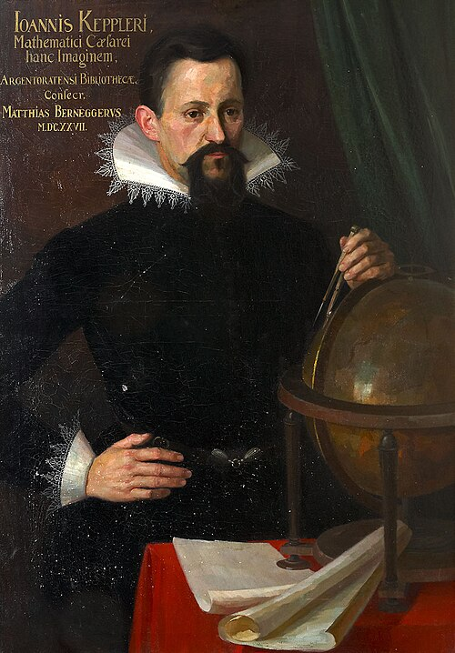

# 约翰内斯·开普勒

**英文名：** Johannes Kepler

**生卒：** 1571年12月27日 — 1630年11月15日

**主要领域：** 天体力学、几何光学

肖像的作者、拍摄或创作年代及具体形式见图片来源。

## 生平简介

德意志天文学家，曾协助第谷并继承其观测资料，长期在宗教和政治动荡中工作。他坚持用精确数据检验行星模型，最终用椭圆轨道取代传统圆周组合，同时在视觉与望远镜光学方面作出重要研究。

## 对物理的主要贡献

- 提出行星运动三定律，给出轨道形状、面积速度及周期的定量规律。
- 解释视网膜成像，研究透镜和望远镜结构，推动近代几何光学。

## 肖像来源与许可

- 来源：[JKepler.jpg](https://commons.wikimedia.org/wiki/File:JKepler.jpg)
- 作者／署名：August Köhler [1]
- 许可：Public domain
- 本地文件：[df6c1cbb94f941cdbc58.jpg](../portraits/df6c1cbb94f941cdbc58.jpg)
- 原始来源说明：Kepler-Museum in Weil der Stadt

## 资料来源

- [MacTutor History of Mathematics — Johannes Kepler](https://mathshistory.st-andrews.ac.uk/Biographies/Kepler/)
- [Wikipedia — Johannes Kepler](https://en.wikipedia.org/wiki/Johannes_Kepler)

资料整理日期：2026-10-26。
