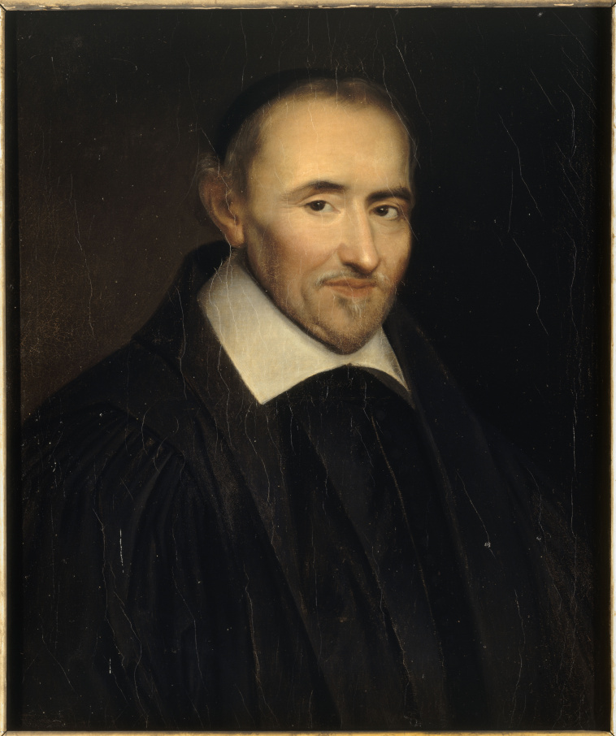

# 皮埃尔·伽桑狄

**英文名：** Pierre Gassendi

**生卒：** 1592年1月22日 — 1655年10月24日

**主要领域：** 原子论史、天文学、运动学史

肖像的作者、拍摄或创作年代及具体形式见图片来源。

## 生平简介

法国哲学家、天文学家和教士，曾在艾克斯及巴黎任教。他重新解释古代原子论以适应近代自然研究，并参与天文观测及运动问题的讨论；1631年观测水星凌日是其著名成果。

## 对物理的主要贡献

- 复兴并改造原子论，推动十七世纪微粒自然观的发展。
- 通过天文观测与运动讨论支持经验研究，记录1631年水星凌日。

## 肖像来源与许可

- 来源：[PierreGassendi.jpg](https://commons.wikimedia.org/wiki/File:PierreGassendi.jpg)
- 作者／署名：Louis-Édouard Rioult (1790–1855)
- 许可：[Public domain](https://commons.wikimedia.org/wiki/Commons:Reuse_of_PD-Art_photographs)
- 本地文件：[52ac2fcff7bde26b0b44.jpg](../portraits/52ac2fcff7bde26b0b44.jpg)
- 原始来源说明：Œuvres complètes de Voltaire – le siècle de Louis XIV

## 资料来源

- [MacTutor History of Mathematics — Pierre Gassendi](https://mathshistory.st-andrews.ac.uk/Biographies/Gassendi/)
- [Wikipedia — Pierre Gassendi](https://en.wikipedia.org/wiki/Pierre_Gassendi)

资料整理日期：2026-10-26。
