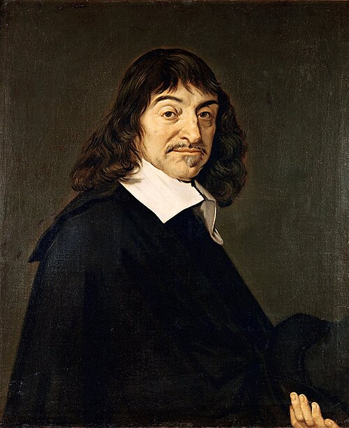

# 勒内·笛卡尔

**英文名：** René Descartes

**生卒：** 1596年3月31日 — 1650年2月11日

**主要领域：** 几何光学、理论物理史

肖像的作者、拍摄或创作年代及具体形式见图片来源。

## 生平简介

法国哲学家和数学家，长期旅居荷兰，晚年应邀赴瑞典。他试图以统一的数学和机械原则解释自然，其光学与解析几何影响深远；有关涡旋宇宙和物体碰撞的部分具体理论后来被修正或取代。

## 对物理的主要贡献

- 在《屈光学》中阐述折射定律，并用光线折射和反射解释虹。
- 发展机械论自然观及运动守恒思想，推动物理问题的数学化。

## 肖像来源与许可

- 来源：[Frans_Hals_-_Portret_van_René_Descartes.jpg](https://commons.wikimedia.org/wiki/File:Frans_Hals_-_Portret_van_Ren%C3%A9_Descartes.jpg)
- 作者／署名：After Frans Hals
- 许可：Public domain
- 本地文件：[efc742b049c1c3153d33.jpg](../portraits/efc742b049c1c3153d33.jpg)
- 原始来源说明：André Hatala [e.a.] (1997) De eeuw van Rembrandt, Bruxelles: Crédit communal de Belgique, ISBN 2-908388-32-4.

## 资料来源

- [MacTutor History of Mathematics — René Descartes](https://mathshistory.st-andrews.ac.uk/Biographies/Descartes/)
- [Wikipedia — René Descartes](https://en.wikipedia.org/wiki/Ren%C3%A9_Descartes)

资料整理日期：2026-10-26。
