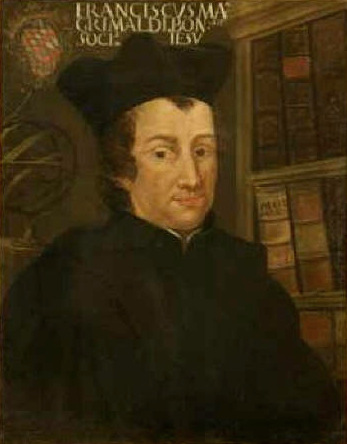

# 弗朗切斯科·玛丽亚·格里马尔迪

**英文名：** Francesco Maria Grimaldi

**生卒：** 1618年4月2日 — 1663年12月28日

**主要领域：** 波动光学、实验力学

肖像的作者、拍摄或创作年代及具体形式见图片来源。

## 生平简介

意大利耶稣会学者，在博洛尼亚从事天文、力学和光学研究，并与里乔利合作观测月球和落体。他的光学著作在去世后出版，其中记录光绕过障碍物边缘后的复杂分布，成为衍射研究的开端。

## 对物理的主要贡献

- 发现并命名光的衍射，观察小孔和障碍物附近的光暗条纹。
- 与里乔利合作开展落体计时和月面观测，推动精密天文及力学实验。

## 史料说明

- 卒日采用MacTutor及通行传记的1663年12月28日；部分网络信息框曾误记8月28日。

## 肖像来源与许可

- 来源：[Francesco_Maria_Grimaldi.jpg](https://commons.wikimedia.org/wiki/File:Francesco_Maria_Grimaldi.jpg)
- 作者／署名：见原图页面
- 许可：Public domain
- 本地文件：[0cbe517c63c11e1f5365-2f74b24686.jpg](../portraits/0cbe517c63c11e1f5365-2f74b24686.jpg)

## 资料来源

- [MacTutor History of Mathematics — Francesco Maria Grimaldi](https://mathshistory.st-andrews.ac.uk/Biographies/Grimaldi/)
- [Wikipedia — Francesco Maria Grimaldi](https://en.wikipedia.org/wiki/Francesco_Maria_Grimaldi)

资料整理日期：2026-10-26。
