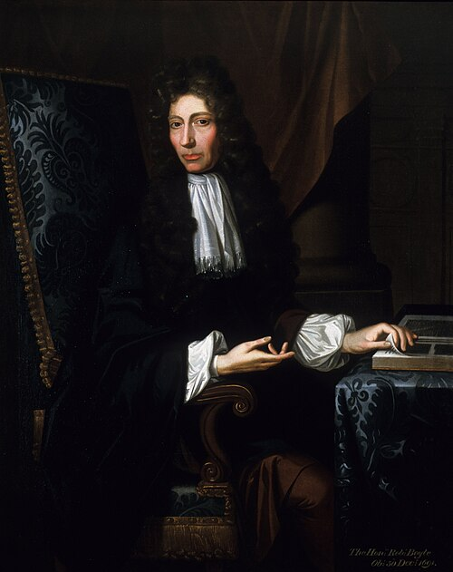

# 罗伯特·玻意耳

**英文名：** Robert Boyle

**生卒：** 1627年1月25日 — 1691年12月30日或31日

**主要领域：** 气体物理、实验方法、物质理论史

肖像的作者、拍摄或创作年代及具体形式见图片来源。

## 生平简介

出生于爱尔兰的实验科学家，主要在英国活动，是皇家学会早期成员。他与胡克等人使用改良空气泵研究气体，主张通过可重复实验和机械解释认识自然，并对近代化学和物理实验传统产生重大影响。

## 对物理的主要贡献

- 建立一定量气体在恒温及适用范围内压力与体积近似成反比的经验规律。
- 利用空气泵研究燃烧、呼吸和声传播等现象，推进气体与真空实验。

## 史料说明

- 卒日来源有1691年12月30日与31日两种记载；本档不将其中一天标作无争议确日。出生日期通常记1月25日，但Birkbeck与科学博物馆个别页面记27日，采用皇家学会等多数资料的25日并保留此差异。

## 肖像来源与许可

- 来源：[The_Shannon_Portrait_of_the_Hon_Robert_Boyle.jpg](https://commons.wikimedia.org/wiki/File:The_Shannon_Portrait_of_the_Hon_Robert_Boyle.jpg)
- 作者／署名：Johann Kerseboom
- 许可：Public domain
- 本地文件：[f0443ce41c4610828462.jpg](../portraits/f0443ce41c4610828462.jpg)
- 原始来源说明：https://digital.sciencehistory.org/works/3r074v879

## 资料来源

- [MacTutor History of Mathematics — Robert Boyle](https://mathshistory.st-andrews.ac.uk/Biographies/Boyle/)
- [Wikipedia — Robert Boyle](https://en.wikipedia.org/wiki/Robert_Boyle)
- [Royal Society — Robert Boyle catalogue](https://catalogues.royalsociety.org/CalmView/Record.aspx?id=NA8137&src=CalmView.Persons)
- [Birkbeck — Robert Boyle: An Introduction](https://boyle.bbk.ac.uk/learn--introduction.html)
- [Dictionary of Irish Biography — Robert Boyle](https://www.dib.ie/index.php/biography/boyle-robert-a0858)
- [Rice University Galileo Project — Robert Boyle](https://galileo.library.rice.edu/Catalog/NewFiles/boyle.html)

资料整理日期：2026-10-26。
