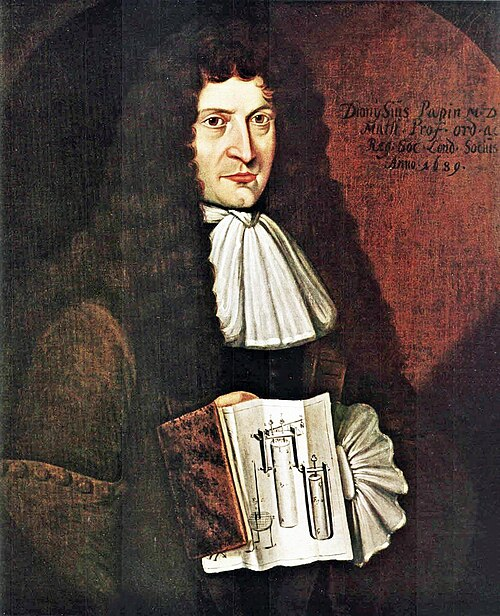

# 德尼·帕潘

**英文名：** Denis Papin

**生卒：** 1647年（8月22日受洗，确切生日不详） — 1713年（8月26日安葬，确切卒日不详）

**主要领域：** 热学史、压力技术、机械工程

肖像的作者、拍摄或创作年代及具体形式见图片来源。

## 生平简介

法国医生出身的发明家，曾与惠更斯和玻意耳合作，后在德国工作。他长期研究蒸汽、压力和机械动力，设计带安全阀的蒸煮器与活塞装置，处于真空实验向蒸汽技术发展的历史交汇处。

## 对物理的主要贡献

- 制造带安全阀的高压蒸煮器，展示受限蒸汽的压力效应。
- 提出利用蒸汽冷凝形成压差推动活塞的装置，促进早期蒸汽动力技术。

## 史料说明

- 皇家学会档案将1647年8月22日列为受洗日、1713年8月26日列为安葬日；不得把它们无条件当作出生和死亡当天。

## 肖像来源与许可

- 来源：[Denis_Papin.jpg](https://commons.wikimedia.org/wiki/File:Denis_Papin.jpg)
- 作者／署名：Johann Peter Engelhard
- 许可：Public domain
- 本地文件：[1e98ce771c59218477df.jpg](../portraits/1e98ce771c59218477df.jpg)
- 原始来源说明：Bildindex der Kunst und Architektur: object 20242788 – image file fmd476392a.jpg

## 资料来源

- [MacTutor History of Mathematics — Denis Papin](https://mathshistory.st-andrews.ac.uk/Biographies/Papin/)
- [Royal Society — Denis Papin, baptism and burial records](https://catalogues.royalsociety.org/calmview/Record.aspx?id=NA5721&src=CalmView.Persons)
- [Wikipedia — Denis Papin](https://en.wikipedia.org/wiki/Denis_Papin)

资料整理日期：2026-10-26。
