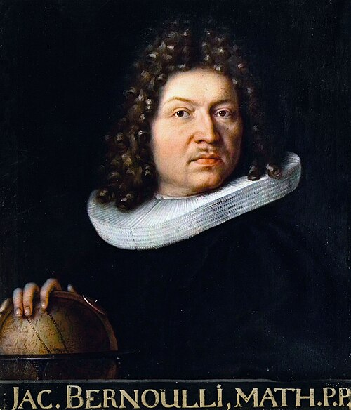

# 雅各布·伯努利

**英文名：** Jacob Bernoulli

**生卒：** 1655年1月6日 — 1705年8月16日

**主要领域：** 变分法、弹性力学

肖像的作者、拍摄或创作年代及具体形式见图片来源。

## 生平简介

瑞士数学家，约翰·伯努利的兄长，长期在巴塞尔任教。他是微积分和变分问题的早期研究者，把曲线、概率与机械问题联系起来，其弹性曲线和悬链线研究影响后来的分析力学。

## 对物理的主要贡献

- 研究悬链线、等时曲线和最速降线等数学物理问题。
- 研究弯曲弹性杆的平衡形状，推进弹性曲线的数学理论。

## 肖像来源与许可

- 来源：[Jakob_Bernoulli.jpg](https://commons.wikimedia.org/wiki/File:Jakob_Bernoulli.jpg)
- 作者／署名：Niklaus Bernoulli (1662-1716)
- 许可：Public domain
- 本地文件：[cfe016246f888cd77b33-3e62a5ee31.jpg](../portraits/cfe016246f888cd77b33-3e62a5ee31.jpg)
- 原始来源说明：[2] [3]

## 资料来源

- [MacTutor History of Mathematics — Jacob Bernoulli](https://mathshistory.st-andrews.ac.uk/Biographies/Bernoulli_Jacob/)
- [Wikipedia — Jacob Bernoulli](https://en.wikipedia.org/wiki/Jacob_Bernoulli)

资料整理日期：2026-10-26。
