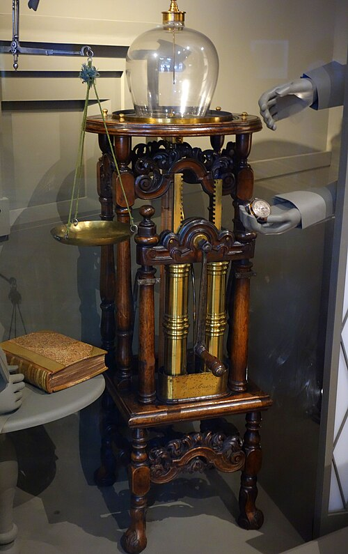

# 弗朗西斯·豪克斯比

**英文名：** Francis Hauksbee

**生卒：** 约1660年 — 1713年4月

**主要领域：** 静电学、气体放电、实验仪器

豪克斯比于1708—1709年制造的气泵，现藏伦敦科学博物馆；这是相关实验仪器图，不是本人肖像。

## 生平简介

英国仪器制造者与实验研究者，出身科尔切斯特，曾在皇家学会进行大量演示。他改进空气泵与摩擦起电装置，系统研究低压气体中的发光和静电现象，1709年出版相关实验著作。

## 对物理的主要贡献

- 改进双筒空气泵及旋转玻璃起电装置。
- 研究电致发光、静电与毛细现象，为十八世纪电学实验传统提供重要基础。

## 史料说明

- 1660年5月27日为受洗日，1713年4月29日为安葬日，不将二者当作确切生卒日；亦须区别同名侄子豪克斯比。

## 肖像来源与许可

- 来源：[Air_pump_made_by_Francis_Hauksbee_the_Elder,_Fleet_Street,_London,_1708-1709,_with_pocket_watch_by_Thomas_Tompion,_1675-1700_-_Science_Museum,_London_-_DSC05624.jpg](https://commons.wikimedia.org/wiki/File:Air_pump_made_by_Francis_Hauksbee_the_Elder,_Fleet_Street,_London,_1708-1709,_with_pocket_watch_by_Thomas_Tompion,_1675-1700_-_Science_Museum,_London_-_DSC05624.jpg)
- 作者／署名：Daderot
- 许可：[CC0](http://creativecommons.org/publicdomain/zero/1.0/deed.en)
- 本地文件：[da59f5aaa0842cdfd8eb-c5a4d83a22.jpg](../portraits/da59f5aaa0842cdfd8eb-c5a4d83a22.jpg)
- 原始来源说明：Own work

## 资料来源

- [Royal Society — Francis Hauksbee](https://makingscience.royalsociety.org/people/na8345/francis-hauksbee)
- [Museo Galileo — Francis Hauksbee Senior](https://catalogue.museogalileo.it/biography/FrancisHauksbeeSenior.html)
- [Wikipedia — Francis Hauksbee](https://en.wikipedia.org/wiki/Francis_Hauksbee)

资料整理日期：2026-10-26。
