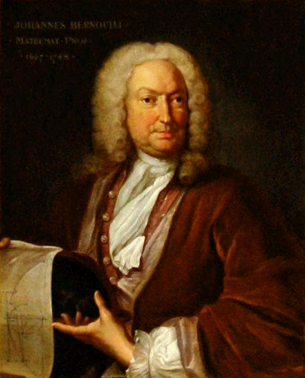

# 约翰·伯努利

**英文名：** Johann Bernoulli

**生卒：** 1667年8月6日 — 1748年1月1日

**主要领域：** 变分法、分析力学、流体力学

肖像的作者、拍摄或创作年代及具体形式见图片来源。

## 生平简介

瑞士数学家，雅各布·伯努利之弟，曾在格罗宁根任教，后接掌巴塞尔数学教席。他发展并传播莱布尼茨微积分，把变分思想用于光学和机械问题，也参与十八世纪活力及流体运动的争论。

## 对物理的主要贡献

- 以最速降线问题推动变分方法的发展。
- 研究光的反射折射、弦振动和流体运动，扩展微积分在物理中的应用。

## 史料说明

- 出生日期采用公历1667年8月6日，对应儒略历7月27日，MacTutor所列为后者。

## 肖像来源与许可

- 来源：[Johann_Bernoulli2.jpg](https://commons.wikimedia.org/wiki/File:Johann_Bernoulli2.jpg)
- 作者／署名：Johann Rudolf Huber
- 许可：Public domain
- 本地文件：[883d3309585b0bb38975-8fee8cfe2b.jpg](../portraits/883d3309585b0bb38975-8fee8cfe2b.jpg)
- 原始来源说明：http://test.maa.org

## 资料来源

- [MacTutor History of Mathematics — Johann Bernoulli](https://mathshistory.st-andrews.ac.uk/Biographies/Bernoulli_Johann/)
- [Wikipedia — Johann Bernoulli](https://en.wikipedia.org/wiki/Johann_Bernoulli)

资料整理日期：2026-10-26。
