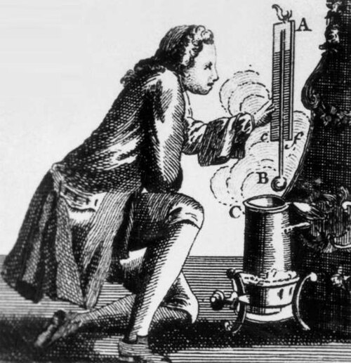

# 丹尼尔·加布里埃尔·华伦海特

**英文名：** Daniel Gabriel Fahrenheit

**生卒：** 1686年5月24日 — 1736年9月16日

**主要领域：** 温度计量、热学

肖像的作者、拍摄或创作年代及具体形式见图片来源。

## 生平简介

出生于但泽的仪器制造者与实验物理研究者，主要在荷兰工作，曾游历欧洲并与罗默等学者交流。他以制造稳定的温度计闻名，把可复制的仪器与温标结合，推动温度从定性冷热感觉走向精密测量。

## 对物理的主要贡献

- 发展可靠的酒精和水银温度计，并建立华氏温标。
- 研究沸点、凝固及压力对温度测量的影响，提升实验温度计量水平。

## 史料说明

- 皇家学会档案列出生日期为1686年5月14日或24日；本档采用Deutsche Biographie的5月24日。

## 肖像来源与许可

- 来源：[Fahrenheit_small.jpg](https://commons.wikimedia.org/wiki/File:Fahrenheit_small.jpg)
- 作者／署名：AnonymousUnknown author
- 许可：Public domain
- 本地文件：[90cc74c979ff44d7544b.jpg](../portraits/90cc74c979ff44d7544b.jpg)
- 原始来源说明：http://www.nndb.com/people/950/000029863/

## 资料来源

- [Royal Society — Daniel Gabriel Fahrenheit](https://makingscience.royalsociety.org/people/na5700/daniel-gabriel-fahrenheit)
- [Deutsche Biographie — Daniel Gabriel Fahrenheit](https://www.deutsche-biographie.de/pnd118685783.html)
- [Wikipedia — Daniel Gabriel Fahrenheit](https://en.wikipedia.org/wiki/Daniel_Gabriel_Fahrenheit)

资料整理日期：2026-10-26。
