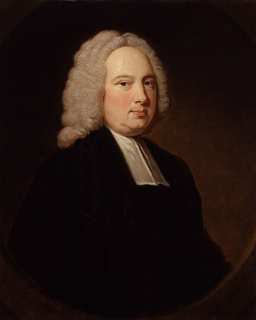

# 詹姆斯·布拉德雷

**英文名：** James Bradley

**生卒：** 1693年3月 — 1762年7月13日

**主要领域：** 天体测量、光学、地球运动

肖像的作者、拍摄或创作年代及具体形式见图片来源。

## 生平简介

英国天文学家，曾任牛津大学萨维尔天文学教授，后任皇家天文学家。他以精密仪器长期追踪恒星位置，最初寻找恒星周年视差，却由观测偏差发现新的效应，显著改进地球运动和天体位置的认识。

## 对物理的主要贡献

- 发现恒星光行差，把地球公转与有限光速联系起来。
- 识别地轴章动，提高天体位置测量与岁差修正的精度。

## 肖像来源与许可

- 来源：[James_Bradley_by_Thomas_Hudson.jpg](https://commons.wikimedia.org/wiki/File:James_Bradley_by_Thomas_Hudson.jpg)
- 作者／署名：After Thomas Hudson
- 许可：Public domain
- 本地文件：[1d88a6f1101975d61c4f.jpg](../portraits/1d88a6f1101975d61c4f.jpg)
- 原始来源说明：one or more third parties have made copyright claims against Wikimedia Commons in relation to the work from which this is sourced or a purely mechanical reproduction thereof. This may be due to recognition of the "sweat of the brow" doctrine, allowing works to be eligible for protection through skill and labour, and not purely by originality as is the case in the United States (where this website is hosted). These claims may or may not be valid in all jurisdictions. As such, use of this image in the jurisdiction of the claimant or other countries may be regarded as copyright infringement. Please see Commons:When to use the PD-Art tag for more information.

## 资料来源

- [MacTutor History of Mathematics — James Bradley](https://mathshistory.st-andrews.ac.uk/Biographies/Bradley/)
- [Wikipedia — James Bradley](https://en.wikipedia.org/wiki/James_Bradley)

资料整理日期：2026-10-26。
